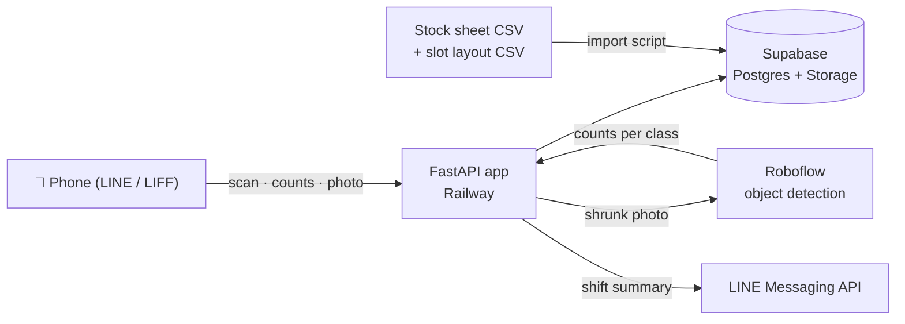

# Stock Count — mobile back-store counting with a computer-vision cross-check


A pilot system that turns a paper stock count into a guided, phone-first workflow inside LINE.
Staff scan a shelf QR code, confirm the quantities on a pre-filled form, and optionally take a photo
that a small object-detection model counts to catch human error. Each shift ends with a variance
report against the system stock, and a weekly report ranks the fastest-moving products.

**Goal of the pilot:** bring a 10–20 minute paper count under **10 minutes** and **20 taps** per round
(1-month pilot, one back store).

## Features
- **Shelf directory & minimap** — every product mapped to a slot code (`L0301` = left side, storey 3, position 1), drawn as a live floor plan with per-slot status
- **QR per shelf** — opens the slot inside LINE (LIFF); the in-page scanner works with the front camera and reads mirrored or colour-inverted codes
- **Fast entry** — quantities pre-filled with the system value, all-or-nothing save per slot, automatic jump to the next slot
- **Input that forgives** — Thai digits, Thai/English number words, voice input, and text typed on the wrong keyboard layout (Kedmanee ↔ QWERTY)
- **CV cross-check** — a Roboflow model counts eight packaging classes per photo (book, jar, paper wrap, bag, spray bottle, box, tote bag, inhaler tin); a slot is flagged when the count differs by more than max(1, 10%)
- **Shift summary & weekly report** — time per round, uncounted slots, mismatches, CV flags, top-3 fast movers; summary pushed to LINE
- **Fails soft** — if the model, LINE or the network is down, counts are still saved

## How it works


## Tech stack
Python 3.12 · FastAPI · Jinja2 · Supabase (Postgres, Storage, RLS) · LINE LIFF & Messaging API · Roboflow · Pillow · qrcode · jsQR (vendored) · pytest · GitHub Actions · Railway

## Accuracy
A predicted box counts as a **true positive** when it overlaps a labelled object with **IoU ≥ 0.5** and the class is correct;
IoU < 0.5 or a wrong class is a false positive, and a missed object is a false negative.
Target: **mAP@50 ≥ 0.80** on the held-out test set, read together with precision (over-counting) and recall (under-counting).

## Privacy & security
- Data stays within ≤ 5 countries (currently Thailand, Japan, Singapore, United States)
- Photos are resized to ≤ 1280 px and stripped of EXIF metadata (including GPS) before storage
- Row-level security on every table; only the server holds the service key
- The LINE identity token is verified with LINE on every login; secrets live in `.env`, never in the repository

## Run it locally
No LINE account needed — dev mode uses the CSV files in `data/`.

```bash
python -m venv .venv
.venv/Scripts/python -m pip install -e ".[dev]"
.venv/Scripts/python -m pytest -q
.venv/Scripts/python scripts/dev_server.py
```
Then open http://localhost:8000. Setup guides for Supabase, LINE and Railway are kept in the project's Obsidian vault.

## Repository layout
| Path | Purpose |
|---|---|
| `src/stockcount/` | app, counting rules, storage, CV and LINE adapters, HTML templates |
| `data/` | stock sheet and slot layout (CSV) |
| `supabase/migrations/` | database schema, applied by GitHub Actions |
| `scripts/` | import, QR labels, minimap, smoke test, dev server |
| `docs/` | dated design specs and implementation plans (Thai + English) |
| `tests/` | 204 pytest tests |

## Credits
Concept inspired by the warehouse stock-checking work of **Fling Asia (Fling.AI)**, extended here for a small retail back store.

## License
Proprietary — internal pilot. All rights reserved.
