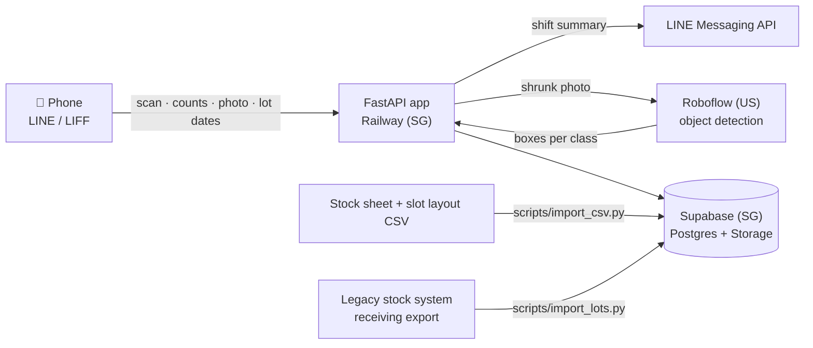

# Stock Count — Avatar Clinic

[](https://github.com/Lemonade678/Avatar_clinic/actions/workflows/tests.yml)

Back-store stock counting for Avatar Clinic branches: a guided, phone-first count inside LINE, a computer-vision cross-check, two-year shelf-life tracking and weekly stock reporting.

| | |
|---|---|
| **Status** | Pilot · MBK branch · 1 month |
| **Branch** | `Stock-count-fork` (forked from `main`) in the [Avatar_clinic](https://github.com/Lemonade678/Avatar_clinic) monorepo |
| **Stack** | Python 3.12 · FastAPI · Supabase · LINE LIFF · Roboflow · Railway |
| **Owner** | Avatar Clinic tech team · maintainer [@Lemonade678](https://github.com/Lemonade678) |

## Contents
[Overview](#overview) · [Features](#features) · [Architecture](#architecture) · [Getting started](#getting-started) · [Configuration](#configuration) · [Database](#database) · [Deployment](#deployment) · [Model evaluation](#model-evaluation) · [Project structure](#project-structure) · [Development workflow](#development-workflow) · [Security and data handling](#security-and-data-handling) · [Roadmap](#roadmap)

## Overview
Branch staff count back-store stock on paper (10–20 minutes a round) and reconcile it later. This service turns the count into a guided flow on the phone:

1. scan the QR code on a shelf storey, or tap the slot on the floor-plan minimap;
2. confirm the quantities, which are pre-filled with the system value (type, speak, or just save when they match);
3. optionally photograph the shelf: an object-detection model counts the packaging per class and flags disagreements;
4. submit the shift: mismatches, timing, CV flags and lots near the two-year limit are pushed to LINE.

**Pilot targets:** under 10 minutes and at most 20 taps per round · model mAP@50 ≥ 0.80 · system cost ≤ 3,000 THB a month (currently about 180 THB).

## Features
| Area | What it does |
|---|---|
| Shelf directory and minimap | Slot code `L0301` = left side · storey 3 · shelf unit 01. Live floor plan with per-slot status; search that tolerates the wrong keyboard layout (Kedmanee ↔ QWERTY) |
| QR scanning | One QR per storey, opened inside LINE (LIFF). The in-page scanner works with front cameras and reads mirrored or colour-inverted codes |
| Counting | System quantities pre-filled, all-or-nothing save per slot, automatic jump to the next slot. Accepts Thai digits, Thai/English number words and voice input |
| CV cross-check | A Roboflow-hosted detector counts nine packaging classes per photo (book, jar, paper wrap, bag, bottle, spray bottle, box, tote bag, inhaler tin); a slot is flagged when a class differs by more than max(1, 10%) |
| Two-year shelf life | The oldest lot per product comes from the date on the pack (typed in) or is estimated first-in-first-out from receiving history exported by the legacy stock system. 🟡 three months before, 🔴 at two years |
| Reporting | Shift summary (time, uncounted slots, mismatches, CV flags, lots running out) pushed to LINE; weekly top-3 fast movers |
| Resilience | Counts are saved even when the model, LINE or the network is unavailable |

## Architecture

Server-rendered HTML (Jinja2) with a small amount of vanilla JavaScript; no frontend build step. LIFF ID tokens are verified with LINE, then a signed session cookie is issued.

## Getting started
**Prerequisites:** Python 3.12 and Git. Supabase, LINE and Roboflow are only needed for production; dev mode serves the CSV files in `data/` from memory.

```bash
python -m venv .venv
.venv/Scripts/python -m pip install -e ".[dev]"
.venv/Scripts/python -m pytest -q
.venv/Scripts/python scripts/dev_server.py
```
Open http://localhost:8000. On macOS/Linux use `.venv/bin/python`.

## Configuration
`config.yaml` holds the non-secret settings: branch, LIFF ID, allow-listed LINE users, default camera, layout file, CV thresholds and the shelf-life rule. Secrets come from environment variables (`.env` locally, Railway variables in production) and are never committed.

| Variable | Needed for | Purpose |
|---|---|---|
| `SESSION_SECRET` | production | Signs the session cookie |
| `SUPABASE_URL`, `SUPABASE_SERVICE_KEY` | production | Database and photo storage; the service key stays on the server |
| `LINE_LIFF_CHANNEL_ID` | production | Verifies LIFF ID tokens |
| `LINE_CHANNEL_ACCESS_TOKEN` | optional | Pushes the shift summary |
| `ROBOFLOW_API_KEY`, `ROBOFLOW_API_URL` | optional | CV cross-check |
| `APP_ENV=dev`, `DEV_USER_ID` | local only | Skips the LINE login; the app refuses to start this way on Railway |

## Database
The schema lives in `supabase/migrations/` and is applied by the `db-migrate` GitHub Actions workflow (`supabase db push`). Applied migrations are never edited; changes go in a new one. Row-level security is on for every table with no policies, so only the server's service key can read or write.

| Script | Purpose |
|---|---|
| `scripts/import_csv.py <stock.csv> <YYYY-MM-DD>` | Load products, slots and a stock snapshot |
| `scripts/import_lots.py <export.csv>` | Load receiving history from the legacy stock system (replaces the previous import) |
| `scripts/make_qr.py` | Printable QR labels per slot (PNG + A4 PDF) |
| `scripts/smoke_supabase.py` | End-to-end check against a real project; cleans up after itself |

## Deployment
Railway (Singapore region) runs the `Procfile` command with a health check on `/health`. Production needs the variables above and a Supabase project in the same region. A push to the deploy branch redeploys the app; database changes ship through the migration workflow.

## Model evaluation
Models are scored the COCO / instance-segmentation way on a held-out test split (`src/stockcount/metrics.py`):

| Metric | Meaning | Target |
|---|---|---|
| mAP@50 | Average precision at IoU 0.50, averaged over classes | ≥ 0.80 |
| mAP@50:95 | Average precision over IoU 0.50–0.95 (rewards tight boxes) | reported |
| Precision · Recall · F1 | At the app's confidence threshold: precision guards against over-counting, recall against under-counting | reported |
| Count accuracy | Share of photos whose per-class counts pass the app's max(1, 10%) rule | reported |
| Inference time | End-to-end per photo (mean, p50, p95) | p95 ≤ 2 s (proposed) |

```bash
.venv/Scripts/python scripts/eval_model.py <roboflow-coco-export>/test
.venv/Scripts/python scripts/eval_model.py <roboflow-coco-export>/test --predictions other-model.json
```
The first candidate is RF-DETR (Apache-2.0 sizes, trained on Roboflow's free plan). Candidates are compared on our own test photos, since COCO scores do not transfer to nine packaging classes in one small room; the reasoning is in the design spec.

## Project structure
| Path | Purpose |
|---|---|
| `src/stockcount/` | App, counting rules, lots and metrics, storage, CV and LINE adapters, templates, static files |
| `data/` | Stock sheet and slot layout (CSV) |
| `supabase/migrations/` | Database schema |
| `scripts/` | Import, QR labels, minimap, model evaluation, smoke test, dev server |
| `docs/specs/`, `docs/plans/` | Dated design specs and implementation plans (Thai is the source of truth, English companion) |
| `tests/` | pytest suite, including an in-memory Supabase fake |

## Development workflow
- `Stock-count-fork` is this service's integration branch, forked from `main` in the Avatar_clinic monorepo. Work on short-lived branches (`feat/…`, `fix/…`, `docs/…`) and open a pull request into `Stock-count-fork`; it reaches `main` through a reviewed pull request.
- Commit messages follow Conventional Commits (`feat:`, `fix:`, `docs:`, `test:`, `chore:`).
- CI (`tests.yml`) must pass before merging; new behaviour arrives with its test, written first.
- Design changes are recorded as a new dated spec in `docs/specs/` instead of rewriting history.

## Security and data handling
- Data stays within at most five countries; today that is Thailand, Japan (LINE), Singapore (Supabase, Railway) and the United States (Roboflow, GitHub).
- Photos are resized to at most 1280 px and stripped of EXIF metadata, GPS included, before storage.
- The repository must stay private: `data/` holds real stock figures.
- Secrets live in environment variables only; logs never contain the Roboflow key.
- Report security problems privately to the maintainers, not in issues.

## Roadmap
- **Phase 1 (pilot):** guided counting, CV cross-check, shelf-life tracking, weekly report.
- **Phase 2:** per-SKU detection, all slots placed, more branches.
- **Phase 3:** a model that keeps learning from photos the counter has already verified.
- **Later:** IoT sensors (shelf weight, fixed cameras).

## Acknowledgements
The concept was inspired by the warehouse stock-checking work of **Fling Asia (Fling.AI)** and adapted for a small retail back store.

## License
Proprietary. © 2026 Avatar Clinic. All rights reserved; internal use only. See [LICENSE](LICENSE).
