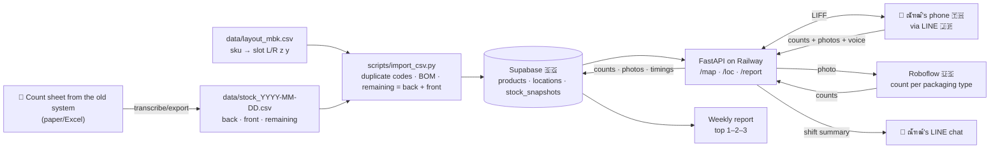

# 📦 Spec — Back-store stock counting (POC · MBK branch)

← [[Project - Stock Count]] · [[Code Hub - Avatar]] · 🇹🇭 ภาษาไทย: [[2026-09-30-stock-count-design]] · 🕘 previous: [[2026-09-29-stock-count-design-en]] · 🆕 ฉบับล่าสุด: [[2026-10-06-stock-count-design-en]]

> The starting idea is inspired by **Fling Asia (Fling.AI)** — ณัฑฒ์'s former workplace — and extended to fit a small retail back store.

## TL;DR
ณัฑฒ์ (the counter during the pilot) taps **Start** → walks to each back-store slot and scans its QR (the front camera works) → **a UI page inside LINE** shows the products in that slot, the expected quantity and the last count → enters the real count (typing, or **speaking** Thai/English) + takes a photo → **a small CV model (Roboflow YOLO) counts from the photo to catch human error** → at the end of the shift taps **Submit** → counts land in Supabase + a mismatch summary + time taken → every week: **top 1–2–3 fast movers** and a weekly stock summary.
A **minimap** (a floor plan like a Siam Paragon mall directory) doubles as the SKU directory — ✅ **prototype built on 30/9** (`scripts/make_minimap.py`).

- **Pilot:** MBK (มาบุญครอง) back store · **1 month** (feedback loop, then iterate) · counter = ณัฑฒ์
- **Phase 1 (this spec):** UI pages + minimap + time clock + counts/photos + small CV cross-check + wrong-keyboard-layout-proof search/input + voice input
- **Phase 2:** per-SKU YOLO · **Phase 3:** self-training model · **Later:** IoT (e.g. weight sensors / fixed shelf cameras) for more accuracy

## Goals / success criteria (over the 1-month pilot)
- Big goal: digital transformation of stock counting → present the pilot results to the company
- ✅ **Under 10 minutes per round** — up to 30 minutes is acceptable while prototyping · why: a paper count takes 10–20 minutes, so a system slower than 10 minutes isn't worth using (the time clock measures every round)
- ✅ **At most 20 taps per round** (about 5 per slot) — a simple MVP
- ✅ Every counting day covers every slot that needs checking
- ✅ Mismatches against the system are visible right after submitting
- ✅ **Model accuracy > 80%** (❓ definition, question 6) · **≤ 2,500 training images**
- ✅ We can count how often CV caught a human error
- ✅ Weekly report: top 1–2–3 fast movers + stock summary

## Constraints (added 30/9)
| Constraint | Effect on the design |
|---|---|
| **Cheap** — compared with a staff salary of roughly < 3,000 THB (❓ question 1) | Free tiers wherever possible: Supabase free · Roboflow free/starter · smallest Railway plan · no extra hardware in phase 1 |
| **At most 1 month to implement for real** | Cut scope to an MVP · anything that doesn't fit (e.g. voice) becomes an optional task at the end of the plan |
| **Data may pass through at most 5 countries** (was "must not leave the country" → relaxed by ณัฑฒ์ to ≤ 5 countries on 30/9) | Currently 4 countries — see "Where the data goes" |
| **Ministry rule: "lasts 2 years"** (❓ question 2) | If it means keep records for 2 years → retain counts/snapshots/photos ≥ 2 years · if it means product shelf life is 2 years → track manufacture/expiry dates |
| **Low light** — small room, 1–2 lamps, some dark corners | The photo screen has a torch button · train on photos taken in this room's real light · flag "too dark" when brightness is low |
| **Trade secrets** | Private repo · RLS on every table · private photo bucket · no public web pages |

## Scope
| In the POC | Out of the POC |
|---|---|
| MBK back store · one counter (ณัฑฒ์) | Front store, other branches, several counters at once |
| **Check only the "front store" (หน้าร้าน) quantity from the sheet** (> 0 = check · 0 = not stocked, skip · negative = the system record is wrong) | The "back store" (หลังร้าน) quantity (later) |
| UI pages inside LINE (LIFF) rendered as HTML by FastAPI · minimap | A separate mobile app |
| One QR per **slot** (e.g. `L0301`) · scanned inside the page, front or back camera selectable | One QR per product |
| CV counts per **packaging type** (bottle/pouch/bag/box/book) | Per-SKU CV (phase 2) |
| Search/input that **repairs a forgotten keyboard switch** Thai↔English (✅ built) · voice input Thai/English | — |
| Starting stock from the 28/9/2026 sheet (105 products · printed header says "สาขาลาดพร้าว" but it is the MBK stock) | Automatic link to the existing stock system |
| Weekly report (estimated from stock decreases) | Real sales from the POS |

## Slot layout (sku directory) — ✅ built 30/9
- **Slot code `<side><z><y>`**, e.g. `L0301` = left side · storey (z) 03 · position (y) 01 · and **x = shelf-unit number** in its own column (MBK has one shelf unit per side → x is always 1) — Cartesian coordinates that scale to more shelf units/branches
- **Layout file:** `data/layout_mbk.csv` (`sku,name,location,shelf`) — all 105 rows, blank = not placed yet · the loader also accepts the headers of ณัฑฒ์'s own sheet (`MBK  directory`, `Postion`)
- The layout comes from this file **instead of** `shelves:` in `config.yaml` (config keeps only settings)
- Now: placed 27/105 · to check 59 · **to check but not placed yet: 40** (the minimap lists them)
- Minimap: seen from the door — left side | aisle | right side · top storey on top · colours by status · search works even when typed in the wrong layout · one file, loads nothing from the internet

## Architecture
```
[QR on slot L0301] ──camera (front/back)──> https://liff.line.me/<LIFF_ID>?loc=L0301
                                              │ (opens inside LINE)
                                              ▼
                        [FastAPI (Python) on Railway — renders the HTML pages]
                          /map          minimap + ⏱️ Start / 📤 Submit + search
                          /loc/L0301    products in the slot + system + last count + inputs/🎤 + 📷
                          /scan         QR scanner in the page (front/back camera · mirrored/inverted images)
                          /report       top 1–2–3 fast movers + weekly stock summary
                            │                   │                    │
                     identity via LINE     Roboflow API          Supabase
                     (LIFF ID token)     (count from photo)   (Postgres + Storage)
                                                                │
                                          LINE Messaging API ── push the shift summary to ณัฑฒ์'s chat
```
- **Python 3.11+** · `fastapi` + `jinja2` · `httpx` · `supabase` · `line-bot-sdk` v3 · `pyyaml` · `qrcode[pil]` · `pytest`
- JavaScript only where needed: LIFF bootstrap · QR scanner (jsQR, vendored into the project, not loaded from a CDN) · search · audio recording
- **UTF-8 everywhere** · human-edited config = `config.yaml` · secrets = `.env` (`LINE_CHANNEL_ACCESS_TOKEN`, `LINE_LIFF_CHANNEL_ID`, `SUPABASE_URL`, `SUPABASE_SERVICE_KEY`, `ROBOFLOW_API_KEY`)
- **The development machine runs Windows** → plan commands are given for both PowerShell and Git Bash

## Data flow — where the CSV goes


## Where the data goes (≤ 5 countries)
| Country | Service | What data |
|---|---|---|
| 🇹🇭 Thailand | ณัฑฒ์'s phone/PC · the back room | everything (source) |
| 🇯🇵 Japan | LINE (LIFF, Messaging API) ⚠️ not verified that LINE Thailand's servers really are in Japan | user identity · summary messages |
| 🇸🇬 Singapore | Supabase · Railway (Singapore region) | counts · photos · timings |
| 🇺🇸 United States | Roboflow · GitHub (private) · Claude | photos (counting/training) · code + CSV |
| **Total: 4** | | a voice-to-text service must sit in one of these 4 countries, or stay within 5 |

## One round (≤ 20 taps)
1. LINE OA → rich menu **"Back-room map"** → minimap (1 tap)
2. **⏱️ Start** (1 tap · starts automatically on the first slot if forgotten)
3. At each slot: scan the QR **or** tap the slot on the minimap (1 tap) → **slot L0301** page shows only products to check (front qty > 0) with system / last count / input (pre-filled with the system value, **so nothing to type when it matches**) → 📷 photo (1 tap) → **Save** (1 tap)
4. The CV result shows immediately: ✅ / ⚠️ "please recount"
5. **📤 Submit shift** (1 tap) → summary: time · slots not counted · mismatched products · CV flags → pushed to LINE
- ⚠️ Counting every slot one by one exceeds 20 taps once there are more than ~5 slots → slots with nothing to check are skipped automatically, and ❓ question 7
- **The counter sees the system quantity** (no blind count) — for transparency, in line with the CEO's vision

## QR scanning (added 30/9)
- Scan **inside the page** (not LINE's own camera) so the camera can be chosen: default = back camera · switchable to the front camera (ณัฑฒ์'s setting = front, because the back camera is broken) · remembered on the device
- Reads codes even when the image is **mirrored** (front cameras often flip) or **colour-inverted** (black↔white): try normal → mirrored → inverted
- Fallback: tapping the slot on the minimap always works, no scan needed
- ⚠️ Not verified yet that LINE's in-app browser can open the camera from a web page on ณัฑฒ์'s phone → the first step of the scanner task tests exactly that

## Voice input, Thai/English (added 30/9)
- 🎤 button on the slot page → say e.g. "อุระกาวาท เก้า" / "mala two" → speech to text → match product + number (Thai and English number words) → fills the field, the counter confirms
- ❓ Question 5: which speech-to-text engine (browser / API service) and whether it belongs in the first month

## Forgotten keyboard switch (added · ✅ built 30/9)
- Typing `v6itdk;km 2 -;f` is understood as `อุระกาวาท 2 ขวด` · typing `ทฟสฟ 2 ยฟแาฟเำ` → `mala 2 package` (Kedmanee layout)
- Only words that become a known product name/unit are converted · number-only words are never touched · used by both search and input

## CV cross-check (small model)
- Roboflow object detection with classes `bottle`, `pouch`, `bag`, `box`, `book` · **≤ 2,500 training images** (start with 50–100, then add) · shot in the MBK room's real light
- Compare per slot, per class: ⚠️ flag when `|cv − entered| > max(1, 10%)` · no model / API down / no photo → saved normally, status "not checked"
- Heavily stacked items (books, pouches in baskets) → CV can be switched off per slot

## Data (Supabase)
| Table | Key columns | Notes |
|---|---|---|
| `products` | `sku` PK, `name`, `category`, `packaging` | from the CSV |
| `locations` | `code` PK (`L0301`), `side`, `storey`, `position`, `shelf`, `cv_enabled` | from the layout CSV (replaces `shelves`) |
| `product_locations` | `sku`, `location_code` | from the layout CSV (replaces `shelf_products`) |
| `stock_snapshots` | `sku`, `back_qty`, `front_qty`, `as_of` | **adds `front_qty`** · expected = `front_qty` |
| `count_sessions` | `id`, `count_date`, `started_at`, `ended_at`, `line_user_id` | time clock |
| `counts` | `session_id`, `location_code`, `sku`, `expected_qty`, `counted_qty`, `input_method` (`type`/`voice`), `updated_at` | |
| `shelf_photos` | `session_id`, `location_code`, `storage_path`, `cv_counts`, `human_counts`, `cv_status`, `brightness` | phase 2–3 dataset |
- Schema changes go in a new migration, never by editing the old one · FKs to `products.sku` use `on update cascade`

## Weekly report
- **Top 1–2–3 fast movers** = sum of `max(0, previous − current)` over the week (increases = restocks, not counted) · ⚠️ an estimate
- **Weekly stock summary:** latest count per SKU · products that often mismatch the system · average counting time · number of CV flags

## Error handling
| Event | What happens |
|---|---|
| Opened outside LINE / token fails | "Open through LINE only" · 401 |
| Not on the allowlist | "No access" · 403 |
| Slot code not in the layout / QR unreadable | "Slot X not found" + link back to the minimap · 404 |
| Empty / non-numeric / negative input | Marks that field, saves nothing · accepts Thai digits ๐–๙ and wrong-layout typing |
| Shift already submitted | Slot page is read-only |
| Photo too dark | Ask for a retake (torch on) or skip |
| Roboflow down / slower than 10 s | Saved normally · CV "not checked" |
| Speech not recognised | Type instead |
| Supabase down | "Save failed, try again" · entered values stay |

## Testing
- **Unit:** ✅ all done (30/9) — slot codes/layout, minimap, wrong keyboard layout, CSV, CV comparison, weekly report, time clock, Thai/English number words · 191 tests
- **Pages:** `TestClient` + fake LINE/Roboflow + `InMemoryRepo` · every page UTF-8 · product names escaped
- **Real:** Supabase smoke script · a real phone (front camera) scanning one slot QR · time one full round + count taps

## Where it runs
- Dev: ณัฑฒ์'s Windows machine + ngrok (LIFF needs HTTPS)
- Pilot: **Railway** (Singapore region) ⚠️ current pricing not checked yet — must fit the budget
- Repo: ณัฑฒ์ creates the private GitHub repo

## ✅ Answered
- Branch = MBK (the 28/9 sheet is the MBK stock) · permission to put up QR codes: **not needed** · LINE OA: **ณัฑฒ์'s own account** · deploy: **Railway** · data: **≤ 5 countries** (Singapore is fine)

## ❓ Open questions (answer after the break)
1. **Budget < 3,000 THB** — does it mean the system may cost at most 3,000 THB per month?
2. **Ministry "lasts 2 years"** — keep stock history for 2 years, or products have a 2-year shelf life (expiry tracking needed)?
3. **Slot code direction:** storey 01 = bottom? position 01 = leftmost when facing the shelf? (the minimap currently draws it that way)
4. **40 products to check without a slot yet** → fill in `data/layout_mbk.csv` (the minimap lists them)
5. **Voice input:** needed in the first month? OK for audio to go to a US service (within the same 4 countries)?
6. **Accuracy > 80%** measured how: the model's mAP@0.5, or "% of slots where the CV count matches the human count"?
7. **One QR per slot** (`L0301` · 6 slots now) or per side (2 codes)? — per slot is faster while counting
