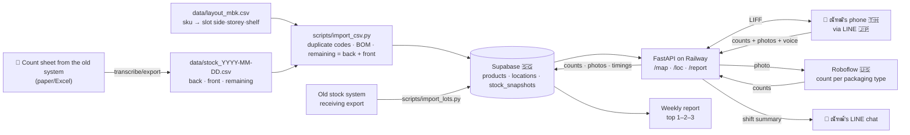

# 📦 Spec — Back-store stock counting (POC · MBK branch)

← [[Project - Stock Count]] · [[Code Hub - Avatar]] · 🇹🇭 ภาษาไทย: [[2026-10-06-stock-count-design]] · 🕘 previous: [[2026-09-30-stock-count-design-en]]

> The starting idea is inspired by **Fling Asia (Fling.AI)** — ณัฑฒ์'s former workplace — and extended to fit a small retail back store.

## TL;DR
ณัฑฒ์ (the counter during the pilot) taps **Start** → walks to each back-store slot and scans its QR (the front camera works) → **a UI page inside LINE** shows the products in that slot, the expected quantity and the last count → enters the real count (typing, or **speaking** Thai/English) + takes a photo → **a CV model (Roboflow · RF-DETR) counts from the photo to catch human error** → at the end of the shift taps **Submit** → counts land in Supabase + a mismatch summary + time taken → every week: **top 1–2–3 fast movers** and a weekly stock summary · a **📅 lots** page warns about products near the two-year limit.
A **minimap** (a floor plan like a Siam Paragon mall directory) doubles as the SKU directory — ✅ **prototype built on 30/9** (`scripts/make_minimap.py`).

- **Pilot:** MBK (มาบุญครอง) back store · **1 month** (feedback loop, then iterate) · counter = ณัฑฒ์
- **Phase 1 (this spec):** UI pages + minimap + time clock + counts/photos + small CV cross-check + wrong-keyboard-layout-proof search/input + voice input
- **Phase 2:** per-SKU detection · **Phase 3:** self-training model · **Later:** IoT (e.g. weight sensors / fixed shelf cameras) for more accuracy

## Goals / success criteria (over the 1-month pilot)
- Big goal: digital transformation of stock counting → present the pilot results to the company
- ✅ **Under 10 minutes per round** — up to 30 minutes is acceptable while prototyping · why: a paper count takes 10–20 minutes, so a system slower than 10 minutes isn't worth using (the time clock measures every round)
- ✅ **At most 20 taps per round** (about 5 per slot) — a simple MVP
- ✅ Every counting day covers every slot that needs checking
- ✅ Mismatches against the system are visible right after submitting
- ✅ **mAP@50 ≥ 0.80** on the test photos, plus mAP@50:95 · precision/recall/F1 · count accuracy · inference time (✅ round 4: scored the instance-segmentation way) · **≤ 2,500 training images**
- ✅ We can count how often CV caught a human error
- ✅ Weekly report: top 1–2–3 fast movers + stock summary

## Constraints (added 30/9)
| Constraint | Effect on the design |
|---|---|
| **Budget ≤ 3,000 THB/month** (system cost · ✅ answered 6/10) | Free tiers wherever possible: Supabase free · Roboflow free/starter · smallest Railway plan · no extra hardware in phase 1 |
| **At most 1 month to implement for real** | Cut scope to an MVP · anything that doesn't fit (e.g. voice) becomes an optional task at the end of the plan |
| **Data may pass through at most 5 countries** (was "must not leave the country" → relaxed by ณัฑฒ์ to ≤ 5 countries on 30/9) | Currently 4 countries — see "Where the data goes" |
| **Shelf life is 2 years for every product** (✅ 6/10 round 3 · supplements such as Touch Up, Tidy, ROZY included · ministry rule for safety and hygiene) | ✅ round 4: lot dates recorded the **A + C** way with 🟡/🔴 warnings → section "Two-year shelf life" · nothing is deleted automatically |
| **Low light** — small room, 1–2 lamps, some dark corners | The photo screen has a torch button · train on photos taken in this room's real light · flag "too dark" when brightness is low |
| **Trade secrets** | Private repo · RLS on every table · private photo bucket · no public web pages |

## Scope
| In the POC | Out of the POC |
|---|---|
| MBK back store · one counter (ณัฑฒ์) | Front store, other branches, several counters at once |
| **Check only the "front store" (หน้าร้าน) quantity from the sheet** (> 0 = check · 0 = not stocked, skip · negative = the system record is wrong) | The "back store" (หลังร้าน) quantity (later) |
| UI pages inside LINE (LIFF) rendered as HTML by FastAPI · minimap | A separate mobile app |
| One QR **per storey** (✅ 6/10) — code `L0301` = left side · storey 3 · shelf unit 01 (✅ round 4: the last two digits are the shelf unit · MBK has one per side), so this equals one per slot · scanned inside the page, front or back camera selectable | One QR per product |
| CV counts per **object type, 9 classes** (book · jar · paper wrap · bag · bottle · spray bottle · box · tote bag · inhaler tin) | Per-SKU CV (phase 2) |
| Search/input that **repairs a forgotten keyboard switch** Thai↔English (✅ built) · voice input Thai/English | — |
| Starting stock from the 28/9/2026 sheet (105 products · printed header says "สาขาลาดพร้าว" but it is the MBK stock) | Automatic link to the existing stock system |
| Weekly report (estimated from stock decreases) | Real sales from the POS |
| **Two-year shelf life** (✅ round 4): oldest lot date from the pack (typed) + an estimate from receiving dates exported by the old system | Every lot with its own quantity (option B) · automatic link to the old system |

## Slot layout (sku directory) — ✅ built 30/9
- **Slot code `<side><storey><shelf>`** (✅ round 4), e.g. `L0301` = left side · storey 03 (counted from the floor) · **shelf unit 01** — the last two digits number the shelf unit (MBK has one per side → always 01) · scales to more units/branches (`L0302` = unit 2)
- **Layout file:** `data/layout_mbk.csv` (`sku,name,location,packaging,packaging_sub`) — all 105 rows, blank = not placed yet · the loader also accepts ณัฑฒ์'s own sheet header (`MBK  directory`) · the sheet's `Postion` column is no longer read (the code already names the shelf)
- The layout comes from this file **instead of** `shelves:` in `config.yaml` (config keeps only settings)
- Now: placed 27/105 · to check 59 · **to check but not placed yet: 40** (the minimap lists them)
- Minimap: seen from the door — left side | aisle | right side · one block = one shelf unit · top storey on top · colours by status · search works even when typed in the wrong layout · one file, loads nothing from the internet

## Architecture
```
[QR on slot L0301] ──camera (front/back)──> https://liff.line.me/<LIFF_ID>?loc=L0301
                                              │ (opens inside LINE)
                                              ▼
                        [FastAPI (Python) on Railway — renders the HTML pages]
                          /map          minimap + ⏱️ Start / 📤 Submit + search
                          /loc/L0301    products in the slot + system + last count + inputs/🎤 + 📷
                          /scan         QR scanner in the page (front/back camera · mirrored/inverted images)
                          /lots         product lots: oldest lot date + two-year warnings
                          /report       top 1–2–3 fast movers + weekly stock summary
                            │                   │                    │
                     identity via LINE     Roboflow API          Supabase
                     (LIFF ID token)     (count from photo)   (Postgres + Storage)
                                                                │
                                          LINE Messaging API ── push the shift summary to ณัฑฒ์'s chat
```
- **Python 3.11+** · `fastapi` + `jinja2` · `httpx` · `supabase` · `line-bot-sdk` v3 · `pyyaml` · `qrcode[pil]` · `pytest`
- JavaScript only where needed: LIFF bootstrap · QR scanner (jsQR, vendored into the project, not loaded from a CDN) · search · audio recording
- **UTF-8 everywhere** · human-edited config = `config.yaml` · secrets = `.env` (`LINE_CHANNEL_ACCESS_TOKEN`, `LINE_LIFF_CHANNEL_ID`, `SUPABASE_URL`, `SUPABASE_SERVICE_KEY`, `ROBOFLOW_API_KEY`)
- **The development machine runs Windows** → plan commands are given for both PowerShell and Git Bash

## Data flow — where the CSV goes


## Where the data goes (≤ 5 countries)
| Country | Service | What data |
|---|---|---|
| 🇹🇭 Thailand | ณัฑฒ์'s phone/PC · the back room | everything (source) |
| 🇯🇵 Japan | LINE (LIFF, Messaging API) ⚠️ not verified that LINE Thailand's servers really are in Japan | user identity · summary messages |
| 🇸🇬 Singapore | Supabase · Railway (Singapore region) | counts · photos · timings |
| 🇺🇸 United States | Roboflow · GitHub (private) · Claude | photos (counting/training) · code + CSV |
| **Total: 4** | | a voice-to-text service must sit in one of these 4 countries, or stay within 5 |

## One round (≤ 20 taps)
1. LINE OA → rich menu **"Back-room map"** → minimap (1 tap)
2. **⏱️ Start** (1 tap · starts automatically on the first slot if forgotten)
3. At each slot: scan the QR **or** tap the slot on the minimap (1 tap) → **slot L0301** page shows only products to check (front qty > 0) with system / last count / input (pre-filled with the system value, **so nothing to type when it matches**) → 📷 photo (1 tap) → **Save** (1 tap)
4. The CV result shows immediately: ✅ / ⚠️ "please recount"
5. **📤 Submit shift** (1 tap) → summary: time · slots not counted · mismatched products · CV flags → pushed to LINE
- ⚠️ Counting every slot one by one exceeds 20 taps once there are more than ~5 slots → slots with nothing to check are skipped automatically, and ❓ question 7
- **The counter sees the system quantity** (no blind count) — for transparency, in line with the CEO's vision

## QR scanning (added 30/9)
- Scan **inside the page** (not LINE's own camera) so the camera can be chosen: default = back camera · switchable to the front camera (ณัฑฒ์'s setting = front, because the back camera is broken) · remembered on the device
- Reads codes even when the image is **mirrored** (front cameras often flip) or **colour-inverted** (black↔white): try normal → mirrored → inverted
- Fallback: tapping the slot on the minimap always works, no scan needed
- ⚠️ Not verified yet that LINE's in-app browser can open the camera from a web page on ณัฑฒ์'s phone → the first step of the scanner task tests exactly that

## Voice input, Thai/English (added 30/9 · ✅ built · to be tried on a real phone)
- **How it works:** on the slot page tap 🎤 → say "อุระกาวาท เก้า" (switch language with the ไทย/EN button) → the **browser's own speech-to-text** turns it into text → our server finds product names **of that slot only** + numbers (digits · Thai digits · words like "เก้า"/"nine") → fills the inputs → **the counter checks and taps save** (nothing is saved automatically)
- **Where the audio goes:** never through our server · the browser sends it to its vendor's speech service (Android/Chrome = Google 🇺🇸, within the same 4 countries) · our server only receives text
- **Limits:** some LINE in-app browsers have no speech recognition → the 🎤 button hides itself · unusual herb names may be misheard → check before saving
- **Why it is only a helper:** inputs are pre-filled with the system value, so when the stock matches nothing needs to be said or typed · voice helps when both hands are busy
- ❓ Question 5: tap 🎤 once on the real phone — if there is no button, skip voice for the pilot

## Forgotten keyboard switch (added · ✅ built 30/9)
- Typing `v6itdk;km 2 -;f` is understood as `อุระกาวาท 2 ขวด` · typing `ทฟสฟ 2 ยฟแาฟเำ` → `mala 2 package` (Kedmanee layout)
- Only words that become a known product name/unit are converted · number-only words are never touched · used by both search and input

## Two-year shelf life — lot dates (✅ round 4: ณัฑฒ์ chose A + C · built)
- **A — from the pack:** on the **📅 lots** page, type the date on the oldest bag/box of each product: `17/6/69` · `17.6.69` (number pads have a dot) · `17/06/2569` · `2026-06-17` · Thai digits · two-digit years 60–99 are Buddhist era · a future or unreadable date is refused with the reason
- **C — from the old system:** export the receiving history (code · date received · quantity) as CSV → `scripts/import_lots.py` (Thai or English headers · re-importing replaces the previous set · typed dates stay · unknown codes are skipped and listed)
- **How they combine:** a typed date **always wins** (it is what the shelf really holds) · products nobody has typed get a **first-in-first-out (FIFO)** estimate: what is left is the newest stock → walk back from the newest receipt until the quantity on hand (back + front) is covered → the receipt reached last is the oldest lot probably still there
  - Example: received 10 (10/1) · 5 (1/3) · 5 (1/5) · on hand 8 → oldest lot ≈ 1/3
  - More on hand than the receipts explain → shown as "≤ date" (older than the data) → warn early
  - A stale typed date (that lot is sold out) warns too early, the safe side of wrong → type a newer date over it · the lots page shows the receipt estimate next to it for comparison
- **Warnings:** 🟡 3 months or less before two years · 🔴 two years reached (adjustable in `config.yaml` → `shelf_life`) · shown on the lots page (worst first · searchable · wrong keyboard layout is fine) · a tag on the slot page · the shift summary + LINE message
- Dates are shown the way they are written on the packs (short Buddhist era, e.g. 17/6/69) · the lots page sits outside the counting round, so it does not use the 20-tap budget
## CV cross-check (small model)
- Roboflow object detection, **9 classes** (✅ 6/10 rounds 3–4): `book` book · `jar` jar (glass or plastic, merged) · `paper_wrap` paper wrap (boiled herbs) · `bag` bag (subclasses: `medicine_bag` blue medicine bag · `supplement_bag` supplement bag) · `bottle` bottle (CABA, banana juice — round 4) · `spray_bottle` spray bottle · `box` box · `tote_bag` tote bag · `tin` inhaler tin · subclasses are product data only, the model is trained on the main class · ⚠️ bottles and spray bottles look alike — label carefully (a spray bottle has a pump head) · **≤ 2,500 training images** (start with 50–100, then add) · shot in the MBK room's real light
- **Accuracy (✅ round 4: the instance-segmentation / COCO way)** — `scripts/eval_model.py` on test photos the model has never seen:

  | Metric | Meaning | Target |
  |---|---|---|
  | **mAP@50** | a predicted box overlapping a real one with **IoU ≥ 50% and the right class = TP** (each real object matches once · duplicates = FP · missed = FN) → AP = area under the 101-point precision–recall curve → averaged over classes | **≥ 0.80** |
  | **mAP@50:95** | AP averaged over IoU 0.50, 0.55 … 0.95 — how tight the boxes are | reported |
  | **precision · recall · F1** | at the app's own confidence (`cv.min_confidence`) · low precision = over-counting · low recall = under-counting · F1 = their harmonic mean | reported |
  | **count accuracy** | share of photos whose per-class counts pass the app's max(1, 10%) rule = how rarely the app cries wolf · ⚠️ the rule always allows one item of slack, so a one-item class mix-up in a small pile still passes → read it next to mAP | proposed ≥ 0.90 |
  | **inference time** | per photo, from sending to answer (network included) · mean / p50 / p95 | proposed p95 ≤ 2 s |
- Instance segmentation uses the same scores with IoU computed on masks instead of boxes · counting only needs boxes (much faster to label than masks) · if masks are ever needed, label polygons and use RF-DETR-Seg from the same family
- Compare per slot, per class: ⚠️ flag when `|cv − entered| > max(1, 10%)` · no model / API down / no photo → saved normally, status "not checked"
- Heavily stacked items (books, pouches in baskets) → CV can be switched off per slot

## Model choice (✅ round 4 — decided by Claude while ณัฑฒ์ let the work continue · can change)
COCO numbers come from each developer's own documents; nobody has re-measured them on our data (the TAPe numbers come from the image ณัฑฒ์ sent and the preprint abstract)

| Model | COCO mAP@50 / @50:95 | Size | Claimed speed | Usable? |
|---|---|---|---|---|
| **RF-DETR-S / M** (Roboflow 🇺🇸) | 72.1 / 53.0 · 73.6 / 54.7 | ~32–34M | 3.5 / 4.4 ms (T4, TensorRT FP16) | ✅ **chosen** — Apache-2.0 · trains on Roboflow's free plan (10 credits/month ≈ 30 trainings) · the data stays where it already is · built for fine-tuning on small datasets (RF100-VL @50:95: 60.2 / 61.2) |
| RF-DETR-2XL | 78.5 / 60.1 | ~127M | 17.2 ms (T4) | ⚠️ PML 1.0 licence, not Apache · too big for nine classes |
| EVA-02-L (BAAI 🇨🇳) + Cascade Mask R-CNN | box 64.1 / mask 55.4 (@50:95) | ~304M (backbone) | not real-time | ❌ training uses 4–8 GPUs · needs our own rented GPU server → over the 3,000 THB/month budget · more than the job needs |
| TAPe+ML v3 (Comexp 🇷🇺) | 84.7 / 65.3 (claimed) | < 0.1M (claimed) | ~10–12 ms (claimed) | ❌ for now — September 2026 preprint, not peer-reviewed · patented method with no public code or weights · nobody has reproduced it · sending data to Russia = a fifth country + legal risk → **watch it**; if code is released, score it with the same script |

- **Principle:** COCO scores (80 everyday classes) do not tell how a model handles nine packaging classes in our dim room → decide with `scripts/eval_model.py` on our own test photos · start with RF-DETR-S, then try M · whichever scores better on the same test set wins
- Sources: [RF-DETR benchmarks](https://rfdetr.roboflow.com/latest/learn/benchmarks/) · [RF-DETR license](https://github.com/roboflow/rf-detr) · [Roboflow pricing](https://roboflow.com/pricing) · [EVA-02 detection](https://github.com/baaivision/EVA/tree/master/EVA-02/det) · [TAPe+ML preprint](https://arxiv.org/abs/2609.20869) · [TAPe / Comexp](https://tape.comexp.net/)
## Data (Supabase)
| Table | Key columns | Notes |
|---|---|---|
| `products` | `sku` PK, `name`, `category`, `packaging` (9 classes), `packaging_sub` | from the CSV |
| `locations` | `code` PK (`L0301`), `side`, `storey`, `shelf`, `cv_enabled` | from the layout CSV · ✅ round 4: `position` dropped · the code must match side + storey + shelf |
| `product_locations` | `sku`, `location_code` | from the layout CSV (replaces `shelf_products`) |
| `stock_snapshots` | `sku`, `back_qty`, `front_qty`, `as_of` | **adds `front_qty`** · expected = `front_qty` |
| `count_sessions` | `id`, `count_date`, `started_at`, `ended_at`, `line_user_id` | time clock |
| `counts` | `session_id`, `location_code`, `sku`, `expected_qty`, `counted_qty`, `input_method` (`type`/`voice`), `updated_at` | |
| `shelf_photos` | `session_id`, `location_code`, `storage_path`, `cv_counts`, `human_counts`, `cv_status`, `brightness` | phase 2–3 dataset · **photos are shrunk before storing** (long side ≤ 1280 px, JPEG, upright, EXIF/GPS dropped) |
| `lot_dates` (round 4) | `sku`, `lot_date`, `source` (`manual` from the pack / `receipt` from the old system), `qty`, `line_user_id`, `recorded_at` | typed dates keep their history, the newest wins · receipts are replaced as a set on every import |
- Schema changes go in a new migration, never by editing the old one · FKs to `products.sku` use `on update cascade`
- ⚠️ Supabase answers at most 1,000 rows per request → the code pages through results ordered by a unique key · stock reads only the newest sheet (✅ fixed in round 4 — unfixed, the weekly report would have gone wrong around week 3 of the pilot)

## Weekly report
- **Top 1–2–3 fast movers** = sum of `max(0, previous − current)` over the week (increases = restocks, not counted) · ⚠️ an estimate
- **Weekly stock summary:** latest count per SKU · products that often mismatch the system · average counting time · number of CV flags

## Error handling
| Event | What happens |
|---|---|
| Opened outside LINE / token fails | "Open through LINE only" · 401 |
| Not on the allowlist | "No access" · 403 |
| Slot code not in the layout / QR unreadable | "Slot X not found" + link back to the minimap · 404 |
| Empty / non-numeric / negative input | Marks that field, saves nothing · accepts Thai digits ๐–๙ and wrong-layout typing |
| Shift already submitted | Slot page is read-only |
| Photo too dark | Ask for a retake (torch on) or skip |
| Roboflow down / slower than 10 s | Saved normally · CV "not checked" |
| Speech not recognised | Type instead |
| Supabase down | "Save failed, try again" · entered values stay |

## Testing
- **Unit:** ✅ all done — slot codes/layout, minimap, wrong keyboard layout, CSV, CV comparison, weekly report, time clock, Thai/English number words + (round 4) lots/two-year shelf life, COCO-style metrics, a Supabase fake with the 1,000-row cap · **284 tests**
- **Pages:** `TestClient` + fake LINE/Roboflow + `InMemoryRepo` · every page UTF-8 · product names escaped
- **Real:** Supabase smoke script · a real phone (front camera) scanning one slot QR · time one full round + count taps

## Where it runs
- Dev: ณัฑฒ์'s Windows machine + ngrok (LIFF needs HTTPS)
- Pilot: **Railway** Hobby $5/month (Singapore region) — see the budget table below
- Repo: **`Lemonade678/Avatar_clinic`** (private · the company's combined repo: backends together, sub-projects on their own branches) → this work lives on branch **`stock-count`** (✅ round 4 · ณัฑฒ์ pushes it — [[guide-push-stock-count-branch]])

## 💰 Monthly budget (answered 6/10: system cost ≤ 3,000 THB/month)
Prices from each vendor's pricing page on 6/10/2026 (~36 THB/USD — approximate)
| Service | Plan | Per month | Enough? |
|---|---|---|---|
| Supabase | Free | 0 | 500 MB DB · 1 GB files · 5 GB egress — photos shrunk to ~150–300 KB → about 2 years of photos · ⚠️ paused after 1 week without activity (Restore in the dashboard) |
| Railway | Hobby | $5 ≈ 180 THB | includes $5 of usage · the Free plan ($1/month) is unlikely to cover an always-on server |
| Roboflow | Free | 0 | private projects · 10 credits/month ≈ 80,000 inferences — we need ~180/month |
| LINE OA | Free | 0 | one summary push per day (~30/month) ⚠️ current Thai free quota not re-checked |
| GitHub | Free | 0 | private repo |
| **Total** | | **≈ 180 THB** | if it grows: Supabase Pro $25 (~900) + Roboflow Core $39 (~1,400) → ~2,500 THB, still within budget |

## ✅ Answered
- Branch = MBK (the 28/9 sheet is the MBK stock) · permission to put up QR codes: **not needed** · LINE OA: **ณัฑฒ์'s own account** · deploy: **Railway** · data: **≤ 5 countries** (Singapore is fine) · **budget = system cost ≤ 3,000 THB/month** (6/10) · **one QR per storey** (6/10) — if a storey ever holds several positions (L0301, L0302), decide then between one QR for the whole storey or one per position · **round 4:** the last two digits of a slot code are the shelf unit (MBK has one) · CABA + banana juice = bottle · lot dates = A + C · scored the instance-segmentation way (mAP@50, mAP@50:95, F1, time) · company-style README + branch `stock-count`

## ❓ Open questions (6/10 round 4 · original numbers)
2. **Can the old stock system export receiving history?** — a CSV for MBK with product code · date received · quantity (Thai or English headers) → run it with [[guide-import-lot-dates]]
3. **Storey 01 = bottom**, right? (the system assumes so · the last two digits = shelf unit ✅)
4. **40 products to check without a slot yet** → fill in `data/layout_mbk.csv`
5. **Voice:** tap 🎤 once on the phone — does it work?
8. **Class per product, Claude's remaining guesses:** tea = bag/medicine_bag · ROZY/CELEB Bag = bag/supplement_bag · boiled herbs = paper_wrap · powders/pills/pellets/capsule supplements = jar · knee spray = spray_bottle · MALA = tin (box sets = box) · Touch Up/Tidy/mexo = box · พัทธะ = tote_bag · books = book — correct? (CABA/banana juice = bottle ✅)
9. **Extra targets Claude proposes:** count accuracy ≥ 0.90 · p95 time ≤ 2 s — OK?
