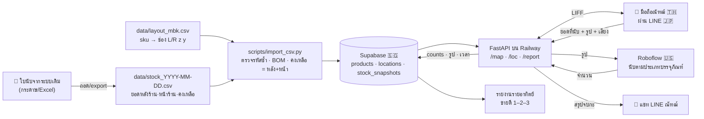

# 📦 Spec — ระบบนับสต็อกหลังร้าน (POC · สาขา MBK)

← [[Project - Stock Count]] · [[Code Hub - Avatar]] · 🇬🇧 English: [[2026-10-06-stock-count-design-en]] · 🕘 ฉบับก่อน: [[2026-09-30-stock-count-design]]

> ไอเดียตั้งต้นได้แรงบันดาลใจจากระบบของ **Fling Asia (Fling.AI)** — ที่ทำงานเก่าของณัฑฒ์ — แล้วต่อยอดให้เหมาะกับร้านค้าปลีกขนาดเล็ก

## TL;DR
ณัฑฒ์ (คนนับใน pilot) กด **เริ่มนับ** → เดินไปแต่ละช่องหลังร้าน สแกน QR (ใช้กล้องหน้าได้) → **หน้า UI ใน LINE** บอกว่าช่องนี้มีสินค้าอะไร ยอดที่ควรมี และยอดที่นับได้ครั้งก่อน → กรอกยอดจริง (พิมพ์ หรือ **พูด** ไทย/อังกฤษ) + ถ่ายรูป → **CV ตัวเล็ก (Roboflow YOLO) นับจากรูปเพื่อจับความผิดพลาดของคน** → จบกะกด **ส่งยอด** → ยอดเข้า Supabase + สรุปรายการที่ไม่ตรง + เวลาที่ใช้ → รายอาทิตย์ดู **สินค้าขายดีอันดับ 1–2–3** และสรุปสต็อกประจำอาทิตย์
มี **minimap** (แผนผังหลังร้านแบบแผนผังห้างใน Siam Paragon) เป็นสารบัญ SKU — ✅ **ต้นแบบทำแล้ว 30/9** (`scripts/make_minimap.py`)

- **Pilot:** สาขามาบุญครอง (MBK) หลังร้าน · **1 เดือน** (รอบ feedback แล้ววนปรับ) · คนนับ = ณัฑฒ์
- **เฟส 1 (spec นี้):** หน้า UI + minimap + time clock + เก็บยอด/รูป + CV ตัวเล็กตรวจยอด + ค้นหา/กรอกที่ทนการลืมเปลี่ยนภาษา + สั่งด้วยเสียง
- **เฟส 2:** YOLO นับแยกทีละ SKU · **เฟส 3:** โมเดลเทรนตัวเอง · **อนาคต:** IoT (เช่น เซนเซอร์น้ำหนัก/กล้องติดชั้น) เพิ่มความแม่นยำ

## เป้าหมาย / วัดผล (ตลอด pilot 1 เดือน)
- เป้าหมายใหญ่: digital transformation ของการนับสต็อก → เอาผล pilot ไปเสนอบริษัท
- ✅ **เวลาต่อรอบ < 10 นาที** — ช่วงต้นแบบให้เวลาทดสอบได้ถึง 30 นาที · เหตุผล: คนนับกระดาษใช้ 10–20 นาที ถ้าระบบช้ากว่า 10 นาทีก็ไม่คุ้มใช้ (time clock วัดทุกรอบ)
- ✅ **กดไม่เกิน 20 ครั้งต่อรอบ** (ประมาณ 5 คลิกต่อช่อง) — เป็น MVP ที่เรียบง่าย
- ✅ ทุกวันที่นับ มีรอบนับครบทุกช่องที่ต้องเช็ค
- ✅ จบกะแล้วเห็นรายการที่ไม่ตรงกับระบบทันที
- ✅ **โมเดลแม่นยำ > 80%** (❓ นิยามดูคำถามข้อ 6) · **รูปเทรนไม่เกิน 2,500 รูป**
- ✅ นับได้ว่า CV จับความผิดพลาดของคนได้กี่ครั้ง
- ✅ รายงานรายอาทิตย์: ขายดีอันดับ 1–2–3 + สรุปสต็อก

## ข้อจำกัด (เพิ่มมา 30/9)
| ข้อจำกัด | ผลต่อการออกแบบ |
|---|---|
| **งบ ≤ 3,000 บาท/เดือน** (ค่าระบบ · ✅ ตอบแล้ว 6/10) | ใช้ free tier ให้มากที่สุด: Supabase free · Roboflow free/starter · Railway แพ็กเล็กสุด · ไม่มีฮาร์ดแวร์เพิ่มในเฟส 1 |
| **ทำจริงได้ไม่เกิน 1 เดือน** | ตัดขอบเขตให้เหลือ MVP · ฟีเจอร์ที่ไม่ทัน (เช่น สั่งด้วยเสียง) ทำเป็นข้อเสริมท้ายแผน |
| **ข้อมูลไหลผ่านได้ไม่เกิน 5 ประเทศ** (เดิม "ห้ามออกนอกประเทศ" → ณัฑฒ์ผ่อนเป็น ≤ 5 ประเทศ 30/9) | ตอนนี้ใช้ 4 ประเทศ ดูตาราง "ข้อมูลไปที่ไหน" |
| **ข้อกำหนดกระทรวง: "อยู่ได้ 2 ปี"** (❓ ข้อ 2) | ถ้าหมายถึงเก็บประวัติ 2 ปี → เก็บ counts/snapshot/รูป ≥ 2 ปี · ถ้าหมายถึงอายุสินค้า 2 ปี → ต้องเก็บวันผลิต/หมดอายุ |
| **แสงน้อย** — ห้องเล็ก ไฟ 1–2 ดวง บางมุมมืด | หน้าถ่ายรูปมีปุ่มเปิดไฟแฟลช · เทรนโมเดลด้วยรูปแสงจริงของห้องนี้ · ติดธง "รูปมืดเกิน" ถ้าความสว่างต่ำ |
| **ความลับทางการค้า** | repo เป็น private · RLS เปิดทุกตาราง · bucket รูปเป็น private · ไม่ publish หน้าเว็บสู่สาธารณะ |

## ขอบเขต
| ใน POC | นอก POC |
|---|---|
| หลังร้าน MBK · คนนับ 1 คน (ณัฑฒ์) | หน้าร้าน, สาขาอื่น, หลายคนนับพร้อมกัน |
| **เช็คเฉพาะยอด "หน้าร้าน" จากใบนับ** (> 0 = ต้องเช็ค · 0 = ไม่มีของ ไม่ต้องเช็ค · ติดลบ = ยอดในระบบผิด) | ยอด "หลังร้าน" (ใช้ภายหลัง) |
| หน้า UI ใน LINE (LIFF) ที่ FastAPI สร้างเป็น HTML · minimap | แอปมือถือแยก |
| QR **ต่อชั้น** (✅ 6/10) — ที่ MBK แต่ละชั้นมีช่องเดียว (ตำแหน่ง 01) จึงเท่ากับ QR ต่อช่อง เช่น `L0301` · สแกนในหน้าเว็บเอง เลือกกล้องหน้า/หลังได้ | QR ต่อสินค้า |
| CV นับรวมตาม **ประเภทบรรจุภัณฑ์** (ขวด/ซอง/ถุง/กล่อง/หนังสือ) | CV แยกทีละ SKU (เฟส 2) |
| ค้นหา/กรอกที่ **ซ่อมการลืมเปลี่ยนภาษา** ไทย↔อังกฤษ (✅ ทำแล้ว) · สั่งด้วยเสียง ไทย/อังกฤษ | — |
| ยอดตั้งต้นจากใบนับ 28/9/2026 (105 สินค้า · ใบพิมพ์หัว "สาขาลาดพร้าว" แต่เป็นสต็อก MBK) | ต่อระบบสต็อกเดิมอัตโนมัติ |
| รายงานรายอาทิตย์ (ประมาณจากยอดที่ลดลง) | ยอดขายจริงจาก POS |

## ผังตำแหน่ง (sku directory) — ✅ ทำแล้ว 30/9
- **รหัสช่อง `<ฝั่ง><z><y>`** เช่น `L0301` = ฝั่งซ้าย · ชั้นที่ (z) 03 · ตำแหน่ง (y) 01 · และ **x = เลขชั้นวาง** อยู่อีกคอลัมน์ (MBK มีชั้นวางฝั่งละ 1 → x = 1 เสมอ) — แบบพิกัดคาร์ทีเซียน ขยายไปหลายชั้นวาง/หลายสาขาได้
- **ไฟล์ผัง:** `data/layout_mbk.csv` (`sku,name,location,shelf`) — ครบ 105 แถว ช่องว่าง = ยังไม่ได้วาง · ตัวอ่านรับหัวคอลัมน์แบบชีตเดิมของณัฑฒ์ (`MBK  directory`, `Postion`) ได้ด้วย
- ผังชั้นมาจากไฟล์นี้ **แทน** `shelves:` ใน `config.yaml` (config เหลือแค่ค่าตั้ง)
- ตอนนี้วางแล้ว 27/105 · ต้องเช็ค 59 · **ต้องเช็คแต่ยังไม่มีตำแหน่ง 40** (หน้า minimap แสดงรายการให้เติม)
- minimap: มองจากประตู ฝั่งซ้าย | ทางเดิน | ฝั่งขวา · ชั้นบนอยู่บน · สีตามสถานะ · ค้นหาพิมพ์ผิดภาษาก็เจอ · ไฟล์เดียว ไม่โหลดอะไรจากเน็ต

## สถาปัตยกรรม
```
[QR ที่ช่อง L0301] ──กล้อง (หน้า/หลัง)──> https://liff.line.me/<LIFF_ID>?loc=L0301
                                           │ (เปิดในแอป LINE)
                                           ▼
                      [FastAPI (Python) บน Railway — สร้างหน้า HTML เอง]
                        /map          minimap + ⏱️ เริ่มนับ / 📤 ส่งยอด + ค้นหา
                        /loc/L0301    สินค้าในช่อง + ระบบ + ครั้งก่อน + ช่องกรอก/🎤 + 📷
                        /scan         สแกน QR ในหน้าเว็บ (กล้องหน้า/หลัง · ภาพกลับด้าน/สีกลับ)
                        /report       ขายดี 1–2–3 + สรุปสต็อกรายอาทิตย์
                          │                   │                    │
                   ตรวจตัวตนผ่าน LINE    Roboflow API         Supabase
                   (LIFF ID token)      (นับจากรูป)     (Postgres + Storage)
                                                              │
                                        LINE Messaging API ── push สรุปจบกะเข้าแชทณัฑฒ์
```
- **Python 3.11+** · `fastapi` + `jinja2` · `httpx` · `supabase` · `line-bot-sdk` v3 · `pyyaml` · `qrcode[pil]` · `pytest`
- JavaScript เท่าที่จำเป็น: ตัวเชื่อม LIFF · ตัวสแกน QR (jsQR เก็บไฟล์ไว้ในโปรเจกต์ ไม่โหลดจาก CDN) · ค้นหา · อัดเสียง
- **UTF-8 ทุกที่** · config คนแก้ = `config.yaml` · ความลับ = `.env` (`LINE_CHANNEL_ACCESS_TOKEN`, `LINE_LIFF_CHANNEL_ID`, `SUPABASE_URL`, `SUPABASE_SERVICE_KEY`, `ROBOFLOW_API_KEY`)
- **เครื่องที่ใช้พัฒนาเป็น Windows** → คำสั่งในแผนมีทั้ง PowerShell และ Git Bash

## Data flow — CSV ไปไหนบ้าง


## ข้อมูลไปที่ไหน (≤ 5 ประเทศ)
| ประเทศ | บริการ | ข้อมูลอะไร |
|---|---|---|
| 🇹🇭 ไทย | มือถือ/คอมณัฑฒ์ · ห้องหลังร้าน | ทุกอย่าง (ต้นทาง) |
| 🇯🇵 ญี่ปุ่น | LINE (LIFF, Messaging API) ⚠️ ยังไม่ได้ยืนยันว่าเซิร์ฟเวอร์ LINE ของไทยอยู่ญี่ปุ่นจริง | ตัวตนผู้ใช้ · ข้อความสรุป |
| 🇸🇬 สิงคโปร์ | Supabase · Railway (เลือก region สิงคโปร์) | ยอด · รูป · เวลา |
| 🇺🇸 อเมริกา | Roboflow · GitHub (private) · Claude | รูป (ตอนนับ/เทรน) · โค้ด + CSV |
| **รวม 4** | | ถ้าเพิ่มบริการสั่งด้วยเสียง ต้องเลือกเจ้าที่อยู่ใน 4 ประเทศนี้ หรือยังไม่เกิน 5 |

## การใช้งาน (1 รอบ · ≤ 20 คลิก)
1. LINE OA → rich menu **"แผนผังหลังร้าน"** → หน้า minimap (1 คลิก)
2. **⏱️ เริ่มนับ** (1 คลิก · ลืมกดก็เริ่มเองตอนเปิดช่องแรก)
3. ที่แต่ละช่อง: สแกน QR **หรือ** แตะช่องบน minimap (1 คลิก) → หน้า **ช่อง L0301** แสดงเฉพาะสินค้าที่ต้องเช็ค (หน้าร้าน > 0) พร้อม ระบบ / ครั้งก่อน / ช่องกรอก (ใส่ค่าระบบไว้ให้ก่อน **ถ้าตรงก็ไม่ต้องพิมพ์**) → 📷 ถ่ายรูป (1 คลิก) → **บันทึก** (1 คลิก)
4. ผล CV ขึ้นทันที ✅ / ⚠️ "ลองนับอีกรอบ"
5. **📤 ส่งยอดจบกะ** (1 คลิก) → สรุป: เวลา · ช่องที่ยังไม่นับ · สินค้าไม่ตรง · ธง CV → push เข้าแชท LINE
- ⚠️ ถ้าต้องนับทุกช่องทีละช่อง จะเกิน 20 คลิก เมื่อจำนวนช่องเกิน ~5 → ตั้งให้ช่องที่ "ไม่มีของต้องเช็ค" ข้ามอัตโนมัติ และ ❓ ข้อ 7
- **แสดงยอดในระบบให้คนนับเห็น** (ไม่ใช้ blind count) — เพื่อความโปร่งใส ตรงกับวิสัยทัศน์ CEO

## สแกน QR (เพิ่มมา 30/9)
- สแกน **ในหน้าเว็บเอง** (ไม่พึ่งกล้องของ LINE) เพื่อเลือกกล้องได้: ค่าเริ่มต้น = กล้องหลัง · ตั้งเป็นกล้องหน้าได้ (ของณัฑฒ์ = กล้องหน้า เพราะกล้องหลังเสีย) · จำค่าไว้ในเครื่อง
- อ่านได้แม้ภาพ **กลับซ้าย-ขวา** (กล้องหน้าชอบกลับภาพ) และ **สีกลับ** (ขาว↔ดำ): ลองอ่านภาพปกติ → ภาพกลับด้าน → ภาพสีกลับ
- สำรอง: แตะช่องบน minimap ได้เสมอ ไม่ต้องสแกน
- ⚠️ ยังไม่ได้ยืนยันว่าเบราว์เซอร์ในแอป LINE เปิดกล้องผ่านหน้าเว็บได้บนมือถือณัฑฒ์ → ทดสอบเป็นขั้นแรกของงานสแกน

## กรอกด้วยเสียง ไทย/อังกฤษ (เพิ่มมา 30/9)
- ปุ่ม 🎤 ในหน้าช่อง → พูด เช่น "อุระกาวาท เก้า" / "mala two" → แปลงเป็นข้อความ → จับคู่สินค้า + ตัวเลข (รองรับเลขคำไทย/อังกฤษ) → เติมลงช่อง ให้กดยืนยันเอง
- ❓ ข้อ 5: เลือกเครื่องแปลงเสียง (เบราว์เซอร์ / บริการ API) และจะอยู่ใน 1 เดือนแรกไหม

## ลืมเปลี่ยนภาษา (เพิ่มมา · ✅ ทำแล้ว 30/9)
- พิมพ์ `v6itdk;km 2 -;f` → เข้าใจเป็น `อุระกาวาท 2 ขวด` · พิมพ์ `ทฟสฟ 2 ยฟแาฟเำ` → `mala 2 package` (ผังแป้น Kedmanee)
- แปลงเฉพาะคำที่แปลงแล้วตรงกับชื่อสินค้า/หน่วยที่รู้จัก · ตัวเลขล้วนไม่แตะ · ใช้ทั้งช่องค้นหาและการกรอก

## CV ตรวจยอด (โมเดลตัวเล็ก)
- Roboflow object detection คลาส `bottle`, `pouch`, `bag`, `box`, `book` · **รูปเทรน ≤ 2,500 รูป** (เริ่ม 50–100 แล้วเพิ่ม) · ถ่ายในแสงจริงของห้อง MBK
- เทียบต่อช่อง ต่อคลาส: ธง ⚠️ เมื่อ `|cv − คนกรอก| > max(1, 10%)` · ไม่มีโมเดล/API ล่ม/ไม่ถ่ายรูป → บันทึกปกติ สถานะ "ไม่ได้ตรวจ"
- ของซ้อนมาก (หนังสือ, ซองในตะกร้า) ปิด CV รายช่องได้

## ข้อมูล (Supabase)
| ตาราง | คอลัมน์หลัก | หมายเหตุ |
|---|---|---|
| `products` | `sku` PK, `name`, `category`, `packaging` | จาก CSV |
| `locations` | `code` PK (`L0301`), `side`, `storey`, `position`, `shelf`, `cv_enabled` | จาก layout CSV (แทน `shelves`) |
| `product_locations` | `sku`, `location_code` | จาก layout CSV (แทน `shelf_products`) |
| `stock_snapshots` | `sku`, `back_qty`, `front_qty`, `as_of` | **เพิ่ม `front_qty`** · expected = `front_qty` |
| `count_sessions` | `id`, `count_date`, `started_at`, `ended_at`, `line_user_id` | time clock |
| `counts` | `session_id`, `location_code`, `sku`, `expected_qty`, `counted_qty`, `input_method` (`type`/`voice`), `updated_at` | |
| `shelf_photos` | `session_id`, `location_code`, `storage_path`, `cv_counts`, `human_counts`, `cv_status`, `brightness` | dataset เฟส 2–3 · **รูปถูกย่อก่อนเก็บ** (ด้านยาว ≤ 1280 px, JPEG, ตั้งตรง, ตัด EXIF/GPS) |
- แก้ schema ด้วย migration ใหม่ ไม่แก้ไฟล์เดิม · FK → `products.sku` ใช้ `on update cascade`

## รายงานรายอาทิตย์
- **ขายดีอันดับ 1–2–3** = ผลรวม `max(0, ครั้งก่อน − ครั้งนี้)` ในอาทิตย์นั้น (ยอดเพิ่ม = ของเข้า ไม่นับ) · ⚠️ ค่าประมาณ
- **สรุปสต็อกประจำอาทิตย์:** ยอดล่าสุดต่อ SKU · สินค้าที่ไม่ตรงกับระบบบ่อย · เวลานับเฉลี่ย · จำนวนธง CV

## Error handling
| เหตุการณ์ | ระบบทำอะไร |
|---|---|
| เปิดนอกแอป LINE / token ไม่ผ่าน | "เปิดผ่าน LINE เท่านั้น" · 401 |
| ไม่อยู่ใน allowlist | "ไม่มีสิทธิ์" · 403 |
| รหัสช่องไม่มีในผัง / QR อ่านไม่ได้ | "ไม่พบช่อง X" + ลิงก์กลับ minimap · 404 |
| กรอกว่าง/ไม่ใช่ตัวเลข/ติดลบ | เตือนที่ช่องนั้น ไม่บันทึกอะไร · รับเลขไทย ๐–๙ และพิมพ์ผิดภาษา |
| ส่งยอดไปแล้ว | หน้าช่องอ่านอย่างเดียว |
| รูปมืดเกิน | ขอถ่ายใหม่ (เปิดแฟลช) หรือข้าม |
| Roboflow ล่ม/ช้าเกิน 10 วิ | บันทึกปกติ · CV "ไม่ได้ตรวจ" |
| แปลงเสียงไม่ได้ | ให้พิมพ์แทน |
| Supabase ล่ม | "บันทึกไม่สำเร็จ ลองอีกครั้ง" · ค่าที่กรอกยังอยู่ |

## การทดสอบ
- **unit:** ✅ ทั้งหมดแล้ว (30/9) — ตำแหน่ง/ผัง, minimap, ลืมเปลี่ยนภาษา, CSV, เทียบ CV, รายงานรายอาทิตย์, time clock, เลขคำไทย/อังกฤษ · รวม 191 ข้อ
- **หน้าเว็บ:** `TestClient` + LINE/Roboflow ปลอม + `InMemoryRepo` · ทุกหน้า UTF-8 · ชื่อสินค้าถูก escape
- **จริง:** Supabase smoke script · มือถือจริง (กล้องหน้า) สแกน QR 1 ช่อง · จับเวลา 1 รอบเต็ม + นับคลิก

## รันที่ไหน
- dev: เครื่อง Windows ของณัฑฒ์ + ngrok (LIFF ต้องการ HTTPS)
- pilot: **Railway** Hobby $5/เดือน (region สิงคโปร์) — ดูตารางงบด้านล่าง
- repo: ณัฑฒ์สร้าง GitHub repo เอง (private)

## 💰 งบรายเดือน (ตอบแล้ว 6/10: ค่าระบบ ≤ 3,000 บาท/เดือน)
ราคาจากหน้าราคาของแต่ละเจ้า ณ 6/10/2026 (อัตรา ~36 บาท/USD — ประมาณ)
| บริการ | แพ็ก | ต่อเดือน | พอไหม |
|---|---|---|---|
| Supabase | Free | 0 | DB 500 MB · ไฟล์ 1 GB · egress 5 GB — รูปย่อเหลือ ~150–300 KB → เก็บได้ราว 2 ปี · ⚠️ ไม่มีใครใช้ 1 สัปดาห์ = โปรเจกต์ถูกพัก (กด Restore ใน dashboard) |
| Railway | Hobby | $5 ≈ 180 บาท | รวมเครดิตใช้งาน $5 · แพ็ก Free ($1/เดือน) ไม่น่าพอสำหรับเซิร์ฟเวอร์เปิดตลอด |
| Roboflow | Free | 0 | โปรเจกต์ private ได้ · 10 เครดิต/เดือน ≈ 80,000 ครั้ง — เราใช้ ~180 ครั้ง/เดือน |
| LINE OA | Free | 0 | push สรุปวันละ 1 ข้อความ (~30/เดือน) ⚠️ ยังไม่ได้เช็กโควตาฟรีล่าสุดของไทย |
| GitHub | Free | 0 | repo private |
| **รวม** | | **≈ 180 บาท** | ถ้าโตเกิน: Supabase Pro $25 (~900) + Roboflow Core $39 (~1,400) → ~2,500 บาท ยังอยู่ในงบ |

## ✅ ตอบแล้ว
- สาขา = MBK (ใบนับ 28/9 คือสต็อก MBK) · ขออนุญาตแปะ QR: **ไม่ต้อง** · LINE OA: **บัญชีณัฑฒ์** · deploy: **Railway** · ข้อมูล: **≤ 5 ประเทศ** (สิงคโปร์ได้) · **งบ = ค่าระบบ ≤ 3,000 บาท/เดือน** (6/10) · **QR ต่อชั้น** (6/10) — ถ้าวันหนึ่งชั้นเดียวมีหลายตำแหน่ง (L0301, L0302) ค่อยตัดสินใจว่าจะใช้ QR เดียวทั้งชั้นหรือแยกตามตำแหน่ง

## ⚙️ ค่าเริ่มต้นที่ใช้สร้างระบบระหว่างรอคำตอบ (เปลี่ยนได้ใน `config.yaml`)
| คำถาม | ใช้ค่านี้ไปก่อน |
|---|---|
| 2 อยู่ได้ 2 ปี | **ไม่ลบข้อมูลอัตโนมัติ** (เก็บได้ ≥ 2 ปีแน่นอน) · ยังไม่ทำระบบวันหมดอายุ |
| 3 ทิศรหัสช่อง | ชั้นที่ 01 = ล่างสุด · ตำแหน่ง 01 = ซ้ายสุด |
| 5 เสียง | ใช้ตัวแปลงเสียงของเบราว์เซอร์ (ไม่ส่งไฟล์เสียงผ่านเซิร์ฟเวอร์เรา) · ถ้าเบราว์เซอร์ใน LINE ไม่รองรับ ปุ่ม 🎤 จะซ่อน |
| 6 ความแม่นยำ | รายงานทั้งสองแบบ: mAP@0.5 ตอนเทรน + % ช่องที่ CV ตรงกับคน ในรายงานรายอาทิตย์ |

## ❓ คำถามค้าง (เลขข้อเดิม · ข้อ 1 และ 7 ตอบแล้ว)
2. **"อยู่ได้ 2 ปี"** ของกระทรวง = ต้องเก็บประวัติสต็อก 2 ปี หรือ สินค้ามีอายุ 2 ปี (ต้องติดตามวันหมดอายุ)?
3. **ทิศของรหัสช่อง:** ชั้นที่ 01 = ล่างสุดใช่ไหม · ตำแหน่ง 01 = ซ้ายสุดเมื่อยืนหันหน้าเข้าชั้นใช่ไหม (minimap ตอนนี้วาดตามนี้)
4. **สินค้า 40 ตัวที่ต้องเช็คแต่ยังไม่มีตำแหน่ง** → เติมใน `data/layout_mbk.csv` (หน้า minimap มีรายชื่อ)
5. **สั่งด้วยเสียง:** ต้องอยู่ใน 1 เดือนแรกไหม · ยอมให้เสียงไปบริการในอเมริกาได้ไหม (อยู่ใน 4 ประเทศเดิม)
6. **ความแม่นยำ > 80%** วัดแบบไหน: mAP@0.5 ของโมเดล หรือ "% ของช่องที่ CV นับตรงกับคน"
8. **ประเภทบรรจุภัณฑ์ที่ Claude เดาไว้** (คอลัมน์ `packaging` ใน `data/layout_mbk.csv`: ผง/เม็ด/ลูกกลอน = ขวด · ชง = ซอง · ต้ม = ถุง · หนังสือ = book · กล่อง/ชุดของขวัญ = box) ถูกไหม
