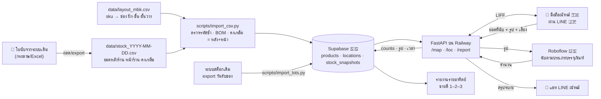

# 📦 Spec — ระบบนับสต็อกหลังร้าน (POC · สาขา MBK)

← [[Project - Stock Count]] · [[Code Hub - Avatar]] · 🇬🇧 English: [[2026-10-06-stock-count-design-en]] · 🕘 ฉบับก่อน: [[2026-09-30-stock-count-design]]

> ไอเดียตั้งต้นได้แรงบันดาลใจจากระบบของ **Fling Asia (Fling.AI)** — ที่ทำงานเก่าของณัฑฒ์ — แล้วต่อยอดให้เหมาะกับร้านค้าปลีกขนาดเล็ก

## TL;DR
ณัฑฒ์ (คนนับใน pilot) กด **เริ่มนับ** → เดินไปแต่ละช่องหลังร้าน สแกน QR (ใช้กล้องหน้าได้) → **หน้า UI ใน LINE** บอกว่าช่องนี้มีสินค้าอะไร ยอดที่ควรมี และยอดที่นับได้ครั้งก่อน → กรอกยอดจริง (พิมพ์ หรือ **พูด** ไทย/อังกฤษ) + ถ่ายรูป → **CV (Roboflow · RF-DETR) นับจากรูปเพื่อจับความผิดพลาดของคน** → จบกะกด **ส่งยอด** → ยอดเข้า Supabase + สรุปรายการที่ไม่ตรง + เวลาที่ใช้ → รายอาทิตย์ดู **สินค้าขายดีอันดับ 1–2–3** และสรุปสต็อกประจำอาทิตย์ · หน้า **📅 ล็อต** เตือนสินค้าใกล้ครบอายุ 2 ปี
มี **minimap** (แผนผังหลังร้านแบบแผนผังห้างใน Siam Paragon) เป็นสารบัญ SKU — ✅ **ต้นแบบทำแล้ว 30/9** (`scripts/make_minimap.py`)

- **Pilot:** สาขามาบุญครอง (MBK) หลังร้าน · **1 เดือน** (รอบ feedback แล้ววนปรับ) · คนนับ = ณัฑฒ์
- **เฟส 1 (spec นี้):** หน้า UI + minimap + time clock + เก็บยอด/รูป + CV ตัวเล็กตรวจยอด + ค้นหา/กรอกที่ทนการลืมเปลี่ยนภาษา + สั่งด้วยเสียง
- **เฟส 2:** โมเดลนับแยกทีละ SKU · **เฟส 3:** โมเดลเทรนตัวเอง · **อนาคต:** IoT (เช่น เซนเซอร์น้ำหนัก/กล้องติดชั้น) เพิ่มความแม่นยำ

## เป้าหมาย / วัดผล (ตลอด pilot 1 เดือน)
- เป้าหมายใหญ่: digital transformation ของการนับสต็อก → เอาผล pilot ไปเสนอบริษัท
- ✅ **เวลาต่อรอบ < 10 นาที** — ช่วงต้นแบบให้เวลาทดสอบได้ถึง 30 นาที · เหตุผล: คนนับกระดาษใช้ 10–20 นาที ถ้าระบบช้ากว่า 10 นาทีก็ไม่คุ้มใช้ (time clock วัดทุกรอบ)
- ✅ **กดไม่เกิน 20 ครั้งต่อรอบ** (ประมาณ 5 คลิกต่อช่อง) — เป็น MVP ที่เรียบง่าย
- ✅ ทุกวันที่นับ มีรอบนับครบทุกช่องที่ต้องเช็ค
- ✅ จบกะแล้วเห็นรายการที่ไม่ตรงกับระบบทันที
- ✅ **mAP@50 ≥ 0.80** บนรูปชุด test + รายงาน mAP@50:95 · precision/recall/F1 · count accuracy · เวลา inference (✅ รอบ 4: วัดแบบเดียวกับ instance segmentation) · **รูปเทรนไม่เกิน 2,500 รูป**
- ✅ นับได้ว่า CV จับความผิดพลาดของคนได้กี่ครั้ง
- ✅ รายงานรายอาทิตย์: ขายดีอันดับ 1–2–3 + สรุปสต็อก

## ข้อจำกัด (เพิ่มมา 30/9)
| ข้อจำกัด | ผลต่อการออกแบบ |
|---|---|
| **งบ ≤ 3,000 บาท/เดือน** (ค่าระบบ · ✅ ตอบแล้ว 6/10) | ใช้ free tier ให้มากที่สุด: Supabase free · Roboflow free/starter · Railway แพ็กเล็กสุด · ไม่มีฮาร์ดแวร์เพิ่มในเฟส 1 |
| **ทำจริงได้ไม่เกิน 1 เดือน** | ตัดขอบเขตให้เหลือ MVP · ฟีเจอร์ที่ไม่ทัน (เช่น สั่งด้วยเสียง) ทำเป็นข้อเสริมท้ายแผน |
| **ข้อมูลไหลผ่านได้ไม่เกิน 5 ประเทศ** (เดิม "ห้ามออกนอกประเทศ" → ณัฑฒ์ผ่อนเป็น ≤ 5 ประเทศ 30/9) | ตอนนี้ใช้ 4 ประเทศ ดูตาราง "ข้อมูลไปที่ไหน" |
| **อายุสินค้า (shelf life) 2 ปีทุกตัว** (✅ 6/10 รอบ 3 · รวมอาหารเสริม เช่น Touch Up, Tidy, ROZY · ตามข้อกำหนดกระทรวงเพื่อความปลอดภัยและสุขาภิบาล) | ✅ รอบ 4: เก็บวันที่ล็อตแบบ **A + C** แล้วเตือน 🟡/🔴 → หัวข้อ "อายุสินค้า 2 ปี" · ไม่ลบข้อมูลอัตโนมัติ |
| **แสงน้อย** — ห้องเล็ก ไฟ 1–2 ดวง บางมุมมืด | หน้าถ่ายรูปมีปุ่มเปิดไฟแฟลช · เทรนโมเดลด้วยรูปแสงจริงของห้องนี้ · ติดธง "รูปมืดเกิน" ถ้าความสว่างต่ำ |
| **ความลับทางการค้า** | repo เป็น private · RLS เปิดทุกตาราง · bucket รูปเป็น private · ไม่ publish หน้าเว็บสู่สาธารณะ |

## ขอบเขต
| ใน POC | นอก POC |
|---|---|
| หลังร้าน MBK · คนนับ 1 คน (ณัฑฒ์) | หน้าร้าน, สาขาอื่น, หลายคนนับพร้อมกัน |
| **เช็คเฉพาะยอด "หน้าร้าน" จากใบนับ** (> 0 = ต้องเช็ค · 0 = ไม่มีของ ไม่ต้องเช็ค · ติดลบ = ยอดในระบบผิด) | ยอด "หลังร้าน" (ใช้ภายหลัง) |
| หน้า UI ใน LINE (LIFF) ที่ FastAPI สร้างเป็น HTML · minimap | แอปมือถือแยก |
| QR **ต่อชั้น** (✅ 6/10) — รหัส `L0301` = ฝั่งซ้าย · ชั้นที่ 3 · ชั้นวาง 01 (✅ รอบ 4: เลข 2 หลักท้ายคือชั้นวาง · MBK มีฝั่งละตู้เดียว) จึงเท่ากับ QR ต่อช่อง · สแกนในหน้าเว็บเอง เลือกกล้องหน้า/หลังได้ | QR ต่อสินค้า |
| CV นับรวมตาม **ประเภทวัตถุ 9 คลาส** (หนังสือ · กระปุก · ห่อกระดาษ · ถุง · ขวด · ขวดสเปรย์ · กล่อง · ถุงผ้า · กระป๋องยาดม) | CV แยกทีละ SKU (เฟส 2) |
| ค้นหา/กรอกที่ **ซ่อมการลืมเปลี่ยนภาษา** ไทย↔อังกฤษ (✅ ทำแล้ว) · สั่งด้วยเสียง ไทย/อังกฤษ | — |
| ยอดตั้งต้นจากใบนับ 28/9/2026 (105 สินค้า · ใบพิมพ์หัว "สาขาลาดพร้าว" แต่เป็นสต็อก MBK) | ต่อระบบสต็อกเดิมอัตโนมัติ |
| รายงานรายอาทิตย์ (ประมาณจากยอดที่ลดลง) | ยอดขายจริงจาก POS |
| **อายุสินค้า 2 ปี** (✅ รอบ 4): วันที่ล็อตเก่าสุดจากถุง (กรอกเอง) + ค่าประมาณจากวันรับของที่ export จากระบบเดิม | เก็บทุกล็อตแยกจำนวน (แบบ B) · ต่อระบบเดิมอัตโนมัติ |

## ผังตำแหน่ง (sku directory) — ✅ ทำแล้ว 30/9
- **รหัสช่อง `<ฝั่ง><ชั้น><ชั้นวาง>`** (✅ รอบ 4) เช่น `L0301` = ฝั่งซ้าย · ชั้นที่ 03 (นับจากล่าง) · **ชั้นวาง 01** — เลข 2 หลักท้ายคือหมายเลขตู้ชั้นวาง (MBK มีฝั่งละ 1 → 01 เสมอ) · ขยายไปหลายตู้/หลายสาขาได้ (`L0302` = ตู้ที่ 2)
- **ไฟล์ผัง:** `data/layout_mbk.csv` (`sku,name,location,packaging,packaging_sub`) — ครบ 105 แถว ช่องว่าง = ยังไม่ได้วาง · อ่านหัวคอลัมน์แบบชีตเดิมของณัฑฒ์ (`MBK  directory`) ได้ · คอลัมน์ `Postion` ของชีตเดิมไม่ใช้แล้ว (รหัสบอกชั้นวางอยู่แล้ว)
- ผังชั้นมาจากไฟล์นี้ **แทน** `shelves:` ใน `config.yaml` (config เหลือแค่ค่าตั้ง)
- ตอนนี้วางแล้ว 27/105 · ต้องเช็ค 59 · **ต้องเช็คแต่ยังไม่มีตำแหน่ง 40** (หน้า minimap แสดงรายการให้เติม)
- minimap: มองจากประตู ฝั่งซ้าย | ทางเดิน | ฝั่งขวา · 1 กล่อง = 1 ตู้ชั้นวาง · ชั้นบนอยู่บน · สีตามสถานะ · ค้นหาพิมพ์ผิดภาษาก็เจอ · ไฟล์เดียว ไม่โหลดอะไรจากเน็ต

## สถาปัตยกรรม
```
[QR ที่ช่อง L0301] ──กล้อง (หน้า/หลัง)──> https://liff.line.me/<LIFF_ID>?loc=L0301
                                           │ (เปิดในแอป LINE)
                                           ▼
                      [FastAPI (Python) บน Railway — สร้างหน้า HTML เอง]
                        /map          minimap + ⏱️ เริ่มนับ / 📤 ส่งยอด + ค้นหา
                        /loc/L0301    สินค้าในช่อง + ระบบ + ครั้งก่อน + ช่องกรอก/🎤 + 📷
                        /scan         สแกน QR ในหน้าเว็บ (กล้องหน้า/หลัง · ภาพกลับด้าน/สีกลับ)
                        /lots         ล็อตสินค้า: วันที่ล็อตเก่าสุด + เตือนอายุ 2 ปี
                        /report       ขายดี 1–2–3 + สรุปสต็อกรายอาทิตย์
                          │                   │                    │
                   ตรวจตัวตนผ่าน LINE    Roboflow API         Supabase
                   (LIFF ID token)      (นับจากรูป)     (Postgres + Storage)
                                                              │
                                        LINE Messaging API ── push สรุปจบกะเข้าแชทณัฑฒ์
```
- **Python 3.11+** · `fastapi` + `jinja2` · `httpx` · `supabase` · `line-bot-sdk` v3 · `pyyaml` · `qrcode[pil]` · `pytest`
- JavaScript เท่าที่จำเป็น: ตัวเชื่อม LIFF · ตัวสแกน QR (jsQR เก็บไฟล์ไว้ในโปรเจกต์ ไม่โหลดจาก CDN) · ค้นหา · อัดเสียง
- **UTF-8 ทุกที่** · config คนแก้ = `config.yaml` · ความลับ = `.env` (`LINE_CHANNEL_ACCESS_TOKEN`, `LINE_LIFF_CHANNEL_ID`, `SUPABASE_URL`, `SUPABASE_SERVICE_KEY`, `ROBOFLOW_API_KEY`)
- **เครื่องที่ใช้พัฒนาเป็น Windows** → คำสั่งในแผนมีทั้ง PowerShell และ Git Bash

## Data flow — CSV ไปไหนบ้าง


## ข้อมูลไปที่ไหน (≤ 5 ประเทศ)
| ประเทศ | บริการ | ข้อมูลอะไร |
|---|---|---|
| 🇹🇭 ไทย | มือถือ/คอมณัฑฒ์ · ห้องหลังร้าน | ทุกอย่าง (ต้นทาง) |
| 🇯🇵 ญี่ปุ่น | LINE (LIFF, Messaging API) ⚠️ ยังไม่ได้ยืนยันว่าเซิร์ฟเวอร์ LINE ของไทยอยู่ญี่ปุ่นจริง | ตัวตนผู้ใช้ · ข้อความสรุป |
| 🇸🇬 สิงคโปร์ | Supabase · Railway (เลือก region สิงคโปร์) | ยอด · รูป · เวลา |
| 🇺🇸 อเมริกา | Roboflow · GitHub (private) · Claude | รูป (ตอนนับ/เทรน) · โค้ด + CSV |
| **รวม 4** | | ถ้าเพิ่มบริการสั่งด้วยเสียง ต้องเลือกเจ้าที่อยู่ใน 4 ประเทศนี้ หรือยังไม่เกิน 5 |

## การใช้งาน (1 รอบ · ≤ 20 คลิก)
1. LINE OA → rich menu **"แผนผังหลังร้าน"** → หน้า minimap (1 คลิก)
2. **⏱️ เริ่มนับ** (1 คลิก · ลืมกดก็เริ่มเองตอนเปิดช่องแรก)
3. ที่แต่ละช่อง: สแกน QR **หรือ** แตะช่องบน minimap (1 คลิก) → หน้า **ช่อง L0301** แสดงเฉพาะสินค้าที่ต้องเช็ค (หน้าร้าน > 0) พร้อม ระบบ / ครั้งก่อน / ช่องกรอก (ใส่ค่าระบบไว้ให้ก่อน **ถ้าตรงก็ไม่ต้องพิมพ์**) → 📷 ถ่ายรูป (1 คลิก) → **บันทึก** (1 คลิก)
4. ผล CV ขึ้นทันที ✅ / ⚠️ "ลองนับอีกรอบ"
5. **📤 ส่งยอดจบกะ** (1 คลิก) → สรุป: เวลา · ช่องที่ยังไม่นับ · สินค้าไม่ตรง · ธง CV → push เข้าแชท LINE
- ⚠️ ถ้าต้องนับทุกช่องทีละช่อง จะเกิน 20 คลิก เมื่อจำนวนช่องเกิน ~5 → ตั้งให้ช่องที่ "ไม่มีของต้องเช็ค" ข้ามอัตโนมัติ และ ❓ ข้อ 7
- **แสดงยอดในระบบให้คนนับเห็น** (ไม่ใช้ blind count) — เพื่อความโปร่งใส ตรงกับวิสัยทัศน์ CEO

## สแกน QR (เพิ่มมา 30/9)
- สแกน **ในหน้าเว็บเอง** (ไม่พึ่งกล้องของ LINE) เพื่อเลือกกล้องได้: ค่าเริ่มต้น = กล้องหลัง · ตั้งเป็นกล้องหน้าได้ (ของณัฑฒ์ = กล้องหน้า เพราะกล้องหลังเสีย) · จำค่าไว้ในเครื่อง
- อ่านได้แม้ภาพ **กลับซ้าย-ขวา** (กล้องหน้าชอบกลับภาพ) และ **สีกลับ** (ขาว↔ดำ): ลองอ่านภาพปกติ → ภาพกลับด้าน → ภาพสีกลับ
- สำรอง: แตะช่องบน minimap ได้เสมอ ไม่ต้องสแกน
- ⚠️ ยังไม่ได้ยืนยันว่าเบราว์เซอร์ในแอป LINE เปิดกล้องผ่านหน้าเว็บได้บนมือถือณัฑฒ์ → ทดสอบเป็นขั้นแรกของงานสแกน

## กรอกด้วยเสียง ไทย/อังกฤษ (เพิ่มมา 30/9 · ✅ ทำแล้ว · รอลองในมือถือจริง)
- **ทำงานยังไง:** ในหน้าช่อง กด 🎤 → พูด "อุระกาวาท เก้า" (สลับภาษาได้ที่ปุ่ม ไทย/EN) → **ตัวแปลงเสียงของเบราว์เซอร์**เปลี่ยนเสียงเป็นข้อความ → เซิร์ฟเวอร์เราหาชื่อสินค้า**เฉพาะในช่องนั้น** + ตัวเลข (เลขอารบิก · เลขไทย · คำว่า "เก้า"/"nine") → เติมลงช่องกรอก → **คนดูแล้วกดบันทึกเอง** (ไม่บันทึกอัตโนมัติ)
- **เสียงไปไหน:** ไฟล์เสียงไม่ผ่านเซิร์ฟเวอร์เรา · เบราว์เซอร์ส่งไปบริการแปลงเสียงของผู้ผลิตเบราว์เซอร์ (Android/Chrome = Google 🇺🇸 อยู่ใน 4 ประเทศเดิม) · เซิร์ฟเวอร์เราได้แค่ข้อความ
- **ข้อจำกัด:** เบราว์เซอร์ในแอป LINE บางเครื่องไม่มีตัวแปลงเสียง → ปุ่ม 🎤 จะซ่อนเอง · ชื่อสมุนไพรเฉพาะอาจฟังผิด → ต้องดูก่อนบันทึก
- **ทำไมเป็นแค่ตัวเสริม:** ช่องกรอกใส่ค่าระบบไว้ให้แล้ว ถ้าของตรงก็ไม่ต้องพูดหรือพิมพ์เลย · เสียงช่วยตอนมือไม่ว่าง (ถือของ/ถือมือถือถ่ายรูป)
- ❓ ข้อ 5: ลองกด 🎤 ในมือถือจริง 1 ครั้ง — ถ้าไม่มีปุ่ม ก็ข้ามเสียงสำหรับ pilot

## ลืมเปลี่ยนภาษา (เพิ่มมา · ✅ ทำแล้ว 30/9)
- พิมพ์ `v6itdk;km 2 -;f` → เข้าใจเป็น `อุระกาวาท 2 ขวด` · พิมพ์ `ทฟสฟ 2 ยฟแาฟเำ` → `mala 2 package` (ผังแป้น Kedmanee)
- แปลงเฉพาะคำที่แปลงแล้วตรงกับชื่อสินค้า/หน่วยที่รู้จัก · ตัวเลขล้วนไม่แตะ · ใช้ทั้งช่องค้นหาและการกรอก

## อายุสินค้า 2 ปี — วันที่ล็อต (✅ รอบ 4: ณัฑฒ์เลือก A + C · ทำแล้ว)
- **A — จากถุง:** หน้า **📅 ล็อต** ใส่วันที่บนถุง/กล่องที่เก่าที่สุดของแต่ละสินค้า พิมพ์ได้ทั้ง `17/6/69` · `17.6.69` (แป้นตัวเลขมีจุด) · `17/06/2569` · `2026-06-17` · เลขไทย · ปี 2 หลัก 60–99 = พ.ศ. · วันที่ในอนาคต/อ่านไม่ออก = ไม่บันทึก + บอกเหตุผล
- **C — จากระบบเดิม:** export ประวัติรับของ (รหัส · วันที่รับ · จำนวน) เป็น CSV → `scripts/import_lots.py` (หัวคอลัมน์ไทยหรืออังกฤษก็ได้ · นำเข้าซ้ำ = แทนชุดเดิม · วันที่ที่กรอกเองไม่หาย · รหัสที่ไม่มีในระบบ = ข้าม + แจ้งรายชื่อ)
- **รวมกันยังไง:** วันที่ที่กรอกเอง **ชนะเสมอ** (ของจริงบนชั้น) · สินค้าที่ยังไม่มีใครกรอก ใช้ค่าประมาณแบบ **เข้าก่อนออกก่อน (FIFO)**: ของที่เหลือคือล็อตที่รับเข้าล่าสุด → ไล่จากใบรับล่าสุดย้อนไปจนครบจำนวนคงเหลือ (หลังร้าน + หน้าร้าน) → ใบสุดท้ายที่ไล่ถึง = ล็อตเก่าสุดที่น่าจะยังอยู่
  - ตัวอย่าง: รับ 10 ชิ้น (10/1) · 5 (1/3) · 5 (1/5) · คงเหลือ 8 → ล็อตเก่าสุด ≈ 1/3
  - คงเหลือมากกว่าที่ใบรับอธิบายได้ → แสดง "≤ วันที่" (เก่ากว่าข้อมูลที่มี) → เตือนไว้ก่อน
  - วันที่กรอกเองที่ค้างเก่า (ล็อตนั้นขายหมดแล้ว) จะเตือนเร็วเกิน = ผิดฝั่งที่ปลอดภัย → กรอกวันที่ใหม่ทับได้ · หน้าล็อตโชว์ค่าประมาณจากวันรับของไว้เทียบ
- **เตือน:** 🟡 เหลือ ≤ 3 เดือนก่อนครบ 2 ปี · 🔴 ครบ 2 ปีแล้ว (ปรับได้ใน `config.yaml` → `shelf_life`) · แสดงที่หน้าล็อต (แย่สุดอยู่บน · ค้นหาได้ · พิมพ์ผิดภาษาก็เจอ) · ป้ายในหน้าช่อง · สรุปจบกะ + ข้อความ LINE
- วันที่แสดงแบบที่เขียนบนถุง (พ.ศ. ย่อ เช่น 17/6/69) · หน้าล็อตอยู่นอกรอบนับ จึงไม่กินโควตา 20 คลิก
## CV ตรวจยอด (โมเดลตัวเล็ก)
- Roboflow object detection **9 คลาส** (✅ 6/10 รอบ 3–4): `book` หนังสือ (เล่ม) · `jar` กระปุก (แก้วหรือพลาสติก รวมกัน) · `paper_wrap` ห่อกระดาษ (ยาต้ม) · `bag` ถุง (subclass: `medicine_bag` ถุงยาสีฟ้า · `supplement_bag` ถุงอาหารเสริม) · `bottle` ขวด (CABA, น้ำกล้วย — รอบ 4) · `spray_bottle` ขวดสเปรย์ · `box` กล่อง · `tote_bag` ถุงผ้า · `tin` กระป๋องยาดม · subclass เก็บเป็นข้อมูลสินค้า โมเดลเทรนแค่คลาสหลัก · ⚠️ ขวดกับขวดสเปรย์หน้าตาใกล้กัน — ตีกรอบให้ตรงคลาส (สเปรย์มีหัวกด) · **รูปเทรน ≤ 2,500 รูป** (เริ่ม 50–100 แล้วเพิ่ม) · ถ่ายในแสงจริงของห้อง MBK
- **วัดความแม่นยำ (✅ รอบ 4: แบบเดียวกับ instance segmentation / COCO)** — `scripts/eval_model.py` บนรูปชุด test ที่โมเดลไม่เคยเห็น:

  | ตัววัด | ความหมาย | เป้า |
  |---|---|---|
  | **mAP@50** | กรอบที่ทายซ้อนของจริง **IoU ≥ 50% + คลาสถูก = TP** (ของจริง 1 ชิ้นจับคู่ได้ครั้งเดียว · ทายซ้ำ = FP · ไม่เจอ = FN) → AP = พื้นที่ใต้กราฟ precision–recall แบบ 101 จุด → เฉลี่ยทุกคลาส | **≥ 0.80** |
  | **mAP@50:95** | เฉลี่ย AP ที่ IoU 0.50, 0.55 … 0.95 — กรอบแนบพอดีแค่ไหน | รายงาน |
  | **precision · recall · F1** | ที่ค่าความมั่นใจเดียวกับแอป (`cv.min_confidence`) · precision ต่ำ = นับเกิน · recall ต่ำ = นับขาด · F1 = ค่าเฉลี่ยฮาร์มอนิกของสองค่า | รายงาน |
  | **count accuracy** | % รูปที่จำนวนต่อคลาสผ่านกฎของแอป max(1, 10%) = แอปจะ "ไม่ร้องเตือนมั่ว" บ่อยแค่ไหน · ⚠️ กฎผ่อนให้ 1 ชิ้นเสมอ ของน้อยชิ้นทายผิดคลาส 1 ชิ้นก็ยังผ่าน → ดูคู่กับ mAP | เสนอ ≥ 0.90 |
  | **เวลา inference** | ต่อรูป ตั้งแต่ส่งจนได้คำตอบ (รวมเน็ต) · mean / p50 / p95 | เสนอ p95 ≤ 2 วิ |
- instance segmentation ใช้สูตรเดียวกัน ต่างแค่คิด IoU จาก mask แทนกรอบ · งานนับใช้กรอบพอ (ตีกรอบเร็วกว่าวาด mask มาก) · ถ้าวันหนึ่งต้องใช้ mask ค่อยติดป้ายแบบ polygon แล้วใช้ RF-DETR-Seg ตระกูลเดียวกัน
- เทียบต่อช่อง ต่อคลาส: ธง ⚠️ เมื่อ `|cv − คนกรอก| > max(1, 10%)` · ไม่มีโมเดล/API ล่ม/ไม่ถ่ายรูป → บันทึกปกติ สถานะ "ไม่ได้ตรวจ"
- ของซ้อนมาก (หนังสือ, ซองในตะกร้า) ปิด CV รายช่องได้

## เลือกโมเดล (✅ รอบ 4 — Claude ตัดสินใจตามที่ณัฑฒ์ให้ไปต่อได้ · เปลี่ยนได้)
ตัวเลข COCO มาจากเอกสารของผู้พัฒนาแต่ละเจ้า ยังไม่มีใครวัดซ้ำบนข้อมูลเรา (ตัวเลข TAPe มาจากรูปที่ณัฑฒ์ส่ง + บทคัดย่อ preprint)

| โมเดล | COCO mAP@50 / @50:95 | ขนาด | ความเร็วที่อ้าง | ใช้ได้ไหม |
|---|---|---|---|---|
| **RF-DETR-S / M** (Roboflow 🇺🇸) | 72.1 / 53.0 · 73.6 / 54.7 | ~32–34M | 3.5 / 4.4 ms (T4, TensorRT FP16) | ✅ **เลือก** — Apache-2.0 · เทรนบน Roboflow แพ็กฟรีได้ (10 เครดิต/เดือน ≈ 30 รอบเทรน) · ข้อมูลไม่ต้องย้ายไปที่ใหม่ · ออกแบบมาให้จูนกับ dataset เล็ก (RF100-VL @50:95: 60.2 / 61.2) |
| RF-DETR-2XL | 78.5 / 60.1 | ~127M | 17.2 ms (T4) | ⚠️ ไลเซนส์ PML 1.0 ไม่ใช่ Apache · ใหญ่เกินงาน 9 คลาส |
| EVA-02-L (BAAI 🇨🇳) + Cascade Mask R-CNN | box 64.1 / mask 55.4 (@50:95) | ~304M (backbone) | ไม่ใช่ real-time | ❌ เทรนใช้ GPU 4–8 ตัว · ต้องเช่าเซิร์ฟเวอร์ GPU เอง → เกินงบ 3,000 บาท/เดือน · เกินความจำเป็น |
| TAPe+ML v3 (Comexp 🇷🇺) | 84.7 / 65.3 (อ้าง) | < 0.1M (อ้าง) | ~10–12 ms (อ้าง) | ❌ ตอนนี้ — preprint ก.ย. 2026 ยังไม่ผ่าน peer review · วิธีจดสิทธิบัตร ไม่มีโค้ด/weights ให้ใช้ · ยังไม่มีใครวัดซ้ำ · ส่งข้อมูลไปรัสเซีย = ประเทศที่ 5 + เสี่ยงด้านกฎหมาย → **เฝ้าดู** ถ้าเปิดโค้ดค่อยวัดด้วยสคริปต์เดียวกัน |

- **หลักคิด:** คะแนน COCO (80 คลาสทั่วไป) ไม่ได้บอกว่าโมเดลจะเก่งกับ 9 คลาสบรรจุภัณฑ์ในห้องแสงน้อยของเรา → ตัดสินด้วย `scripts/eval_model.py` บนรูปชุด test ของเราเอง · เริ่ม RF-DETR-S แล้วลอง M เทียบ · ตัวไหนวัดได้ดีกว่าบนชุดเดียวกันค่อยใช้ตัวนั้น
- แหล่ง: [RF-DETR benchmarks](https://rfdetr.roboflow.com/latest/learn/benchmarks/) · [RF-DETR license](https://github.com/roboflow/rf-detr) · [Roboflow pricing](https://roboflow.com/pricing) · [EVA-02 detection](https://github.com/baaivision/EVA/tree/master/EVA-02/det) · [TAPe+ML preprint](https://arxiv.org/abs/2609.20869) · [TAPe / Comexp](https://tape.comexp.net/)
## ข้อมูล (Supabase)
| ตาราง | คอลัมน์หลัก | หมายเหตุ |
|---|---|---|
| `products` | `sku` PK, `name`, `category`, `packaging` (9 คลาส), `packaging_sub` | จาก CSV |
| `locations` | `code` PK (`L0301`), `side`, `storey`, `shelf`, `cv_enabled` | จาก layout CSV · ✅ รอบ 4: ตัด `position` · รหัสต้องตรงกับ ฝั่ง+ชั้น+ชั้นวาง |
| `product_locations` | `sku`, `location_code` | จาก layout CSV (แทน `shelf_products`) |
| `stock_snapshots` | `sku`, `back_qty`, `front_qty`, `as_of` | **เพิ่ม `front_qty`** · expected = `front_qty` |
| `count_sessions` | `id`, `count_date`, `started_at`, `ended_at`, `line_user_id` | time clock |
| `counts` | `session_id`, `location_code`, `sku`, `expected_qty`, `counted_qty`, `input_method` (`type`/`voice`), `updated_at` | |
| `shelf_photos` | `session_id`, `location_code`, `storage_path`, `cv_counts`, `human_counts`, `cv_status`, `brightness` | dataset เฟส 2–3 · **รูปถูกย่อก่อนเก็บ** (ด้านยาว ≤ 1280 px, JPEG, ตั้งตรง, ตัด EXIF/GPS) |
| `lot_dates` (รอบ 4) | `sku`, `lot_date`, `source` (`manual` จากถุง / `receipt` จากระบบเดิม), `qty`, `line_user_id`, `recorded_at` | กรอกเอง = เก็บประวัติ ใช้อันล่าสุด · receipt = แทนทั้งชุดทุกครั้งที่นำเข้า |
- แก้ schema ด้วย migration ใหม่ ไม่แก้ไฟล์เดิม · FK → `products.sku` ใช้ `on update cascade`
- ⚠️ Supabase ตอบได้ครั้งละ ≤ 1,000 แถว → โค้ดอ่านเป็นหน้า ๆ เรียงตามคีย์ · ยอดสต็อกอ่านเฉพาะใบนับล่าสุด (✅ แก้รอบ 4 — ถ้าไม่แก้ รายงานรายอาทิตย์จะเพี้ยนตั้งแต่ราวสัปดาห์ที่ 3 ของ pilot)

## รายงานรายอาทิตย์
- **ขายดีอันดับ 1–2–3** = ผลรวม `max(0, ครั้งก่อน − ครั้งนี้)` ในอาทิตย์นั้น (ยอดเพิ่ม = ของเข้า ไม่นับ) · ⚠️ ค่าประมาณ
- **สรุปสต็อกประจำอาทิตย์:** ยอดล่าสุดต่อ SKU · สินค้าที่ไม่ตรงกับระบบบ่อย · เวลานับเฉลี่ย · จำนวนธง CV

## Error handling
| เหตุการณ์ | ระบบทำอะไร |
|---|---|
| เปิดนอกแอป LINE / token ไม่ผ่าน | "เปิดผ่าน LINE เท่านั้น" · 401 |
| ไม่อยู่ใน allowlist | "ไม่มีสิทธิ์" · 403 |
| รหัสช่องไม่มีในผัง / QR อ่านไม่ได้ | "ไม่พบช่อง X" + ลิงก์กลับ minimap · 404 |
| กรอกว่าง/ไม่ใช่ตัวเลข/ติดลบ | เตือนที่ช่องนั้น ไม่บันทึกอะไร · รับเลขไทย ๐–๙ และพิมพ์ผิดภาษา |
| ส่งยอดไปแล้ว | หน้าช่องอ่านอย่างเดียว |
| รูปมืดเกิน | ขอถ่ายใหม่ (เปิดแฟลช) หรือข้าม |
| Roboflow ล่ม/ช้าเกิน 10 วิ | บันทึกปกติ · CV "ไม่ได้ตรวจ" |
| แปลงเสียงไม่ได้ | ให้พิมพ์แทน |
| Supabase ล่ม | "บันทึกไม่สำเร็จ ลองอีกครั้ง" · ค่าที่กรอกยังอยู่ |

## การทดสอบ
- **unit:** ✅ ทั้งหมดแล้ว — ตำแหน่ง/ผัง, minimap, ลืมเปลี่ยนภาษา, CSV, เทียบ CV, รายงานรายอาทิตย์, time clock, เลขคำไทย/อังกฤษ + (รอบ 4) ล็อต/อายุ 2 ปี, ตัววัดแบบ COCO, Supabase ปลอมที่มีเพดาน 1,000 แถว · รวม **284 ข้อ**
- **หน้าเว็บ:** `TestClient` + LINE/Roboflow ปลอม + `InMemoryRepo` · ทุกหน้า UTF-8 · ชื่อสินค้าถูก escape
- **จริง:** Supabase smoke script · มือถือจริง (กล้องหน้า) สแกน QR 1 ช่อง · จับเวลา 1 รอบเต็ม + นับคลิก

## รันที่ไหน
- dev: เครื่อง Windows ของณัฑฒ์ + ngrok (LIFF ต้องการ HTTPS)
- pilot: **Railway** Hobby $5/เดือน (region สิงคโปร์) — ดูตารางงบด้านล่าง
- repo: **`Lemonade678/Avatar_clinic`** (private · repo รวมของบริษัท แบ็กเอนด์รวมกัน งานย่อยแยก branch) → งานนี้อยู่ branch **`Stock-count-fork`** (แตกจาก main · ✅ รอบ 4 · ไลเซนส์ของบริษัท ห้ามใช้ภายนอก · ⚠️ repo ยังเป็น Public ต้องเปลี่ยนเป็น Private · ณัฑฒ์เป็นคน push — [[guide-push-stock-count-branch]])

## 💰 งบรายเดือน (ตอบแล้ว 6/10: ค่าระบบ ≤ 3,000 บาท/เดือน)
ราคาจากหน้าราคาของแต่ละเจ้า ณ 6/10/2026 (อัตรา ~36 บาท/USD — ประมาณ)
| บริการ | แพ็ก | ต่อเดือน | พอไหม |
|---|---|---|---|
| Supabase | Free | 0 | DB 500 MB · ไฟล์ 1 GB · egress 5 GB — รูปย่อเหลือ ~150–300 KB → เก็บได้ราว 2 ปี · ⚠️ ไม่มีใครใช้ 1 สัปดาห์ = โปรเจกต์ถูกพัก (กด Restore ใน dashboard) |
| Railway | Hobby | $5 ≈ 180 บาท | รวมเครดิตใช้งาน $5 · แพ็ก Free ($1/เดือน) ไม่น่าพอสำหรับเซิร์ฟเวอร์เปิดตลอด |
| Roboflow | Free | 0 | โปรเจกต์ private ได้ · 10 เครดิต/เดือน ≈ 80,000 ครั้ง — เราใช้ ~180 ครั้ง/เดือน |
| LINE OA | Free | 0 | push สรุปวันละ 1 ข้อความ (~30/เดือน) ⚠️ ยังไม่ได้เช็กโควตาฟรีล่าสุดของไทย |
| GitHub | Free | 0 | repo private |
| **รวม** | | **≈ 180 บาท** | ถ้าโตเกิน: Supabase Pro $25 (~900) + Roboflow Core $39 (~1,400) → ~2,500 บาท ยังอยู่ในงบ |

## ✅ ตอบแล้ว
- สาขา = MBK (ใบนับ 28/9 คือสต็อก MBK) · ขออนุญาตแปะ QR: **ไม่ต้อง** · LINE OA: **บัญชีณัฑฒ์** · deploy: **Railway** · ข้อมูล: **≤ 5 ประเทศ** (สิงคโปร์ได้) · **งบ = ค่าระบบ ≤ 3,000 บาท/เดือน** (6/10) · **QR ต่อชั้น** (6/10) — ถ้าวันหนึ่งชั้นเดียวมีหลายตำแหน่ง (L0301, L0302) ค่อยตัดสินใจว่าจะใช้ QR เดียวทั้งชั้นหรือแยกตามตำแหน่ง · **รอบ 4:** เลข 2 หลักท้ายของรหัสช่อง = ชั้นวาง (MBK มีตู้เดียว) · CABA + น้ำกล้วย = ขวด · วันที่ล็อต = A + C · วัดผลแบบ instance segmentation (mAP@50, mAP@50:95, F1, เวลา) · README แบบ repo บริษัท + branch `Stock-count-fork` + ไลเซนส์ของบริษัท

## ⚙️ ค่าเริ่มต้นที่ใช้สร้างระบบระหว่างรอคำตอบ (เปลี่ยนได้ใน `config.yaml`)
| คำถาม | ใช้ค่านี้ไปก่อน |
|---|---|
| 2 กฎ 2 ปี | ✅ ตอบแล้ว (รอบ 4): A + C — ทำแล้ว · ไม่ลบข้อมูลอัตโนมัติ |
| 3 ทิศรหัสช่อง | ชั้นที่ 01 = ล่างสุด · เลข 2 หลักท้าย = ชั้นวาง (✅ รอบ 4) |
| 5 เสียง | ใช้ตัวแปลงเสียงของเบราว์เซอร์ (ไม่ส่งไฟล์เสียงผ่านเซิร์ฟเวอร์เรา) · ถ้าเบราว์เซอร์ใน LINE ไม่รองรับ ปุ่ม 🎤 จะซ่อน |
| 6 ความแม่นยำ | ✅ ตอบแล้ว (รอบ 4): mAP@50 ≥ 0.80 + mAP@50:95 · precision/recall/F1 · count accuracy · เวลา inference |
| 9 โมเดล | RF-DETR-S บน Roboflow แพ็กฟรี (เทียบกับ M ด้วยสคริปต์วัดผล) |

## ❓ คำถามค้าง (6/10 รอบ 4 · เลขข้อเดิม)
2. **ระบบสต็อกเดิม export ได้ไหม** — ขอไฟล์ CSV ประวัติรับของของ MBK: รหัสสินค้า · วันที่รับ · จำนวน (หัวคอลัมน์ไทยหรืออังกฤษก็ได้) → รันตาม [[guide-import-lot-dates]]
3. **ชั้นที่ 01 = ล่างสุด** ใช่ไหม (ตอนนี้ระบบถือแบบนี้ · เลข 2 หลักท้าย = ชั้นวาง ✅ แล้ว)
4. **สินค้า 40 ตัวที่ต้องเช็คแต่ยังไม่มีตำแหน่ง** → เติมใน `data/layout_mbk.csv`
5. **เสียง:** ลองกด 🎤 ในมือถือ 1 ครั้ง — ใช้ได้ไหม
8. **คลาสต่อสินค้าที่ Claude เดา (ที่เหลือ):** ชง = ถุง/ถุงยาสีฟ้า · ROZY/CELEB Bag = ถุง/ถุงอาหารเสริม · ต้ม = ห่อกระดาษ · ผง/เม็ด/ลูกกลอน/อาหารเสริมแคปซูล = กระปุก · สเปรย์ฉีดเข่า = ขวดสเปรย์ · MALA = กระป๋องยาดม (ชุดกล่อง = กล่อง) · Touch Up/Tidy/เมซโซ = กล่อง · พัทธะ = ถุงผ้า · หนังสือ = เล่ม — ถูกไหม (CABA/น้ำกล้วย = ขวด ✅)
9. **เป้าเสริมที่ Claude เสนอ:** count accuracy ≥ 0.90 · เวลา p95 ≤ 2 วิ — โอเคไหม
